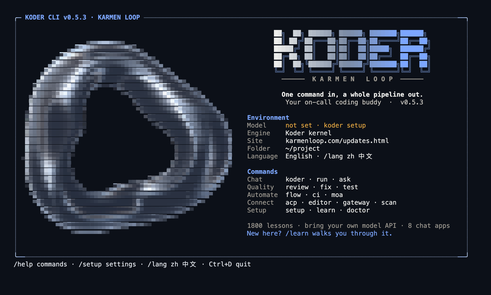
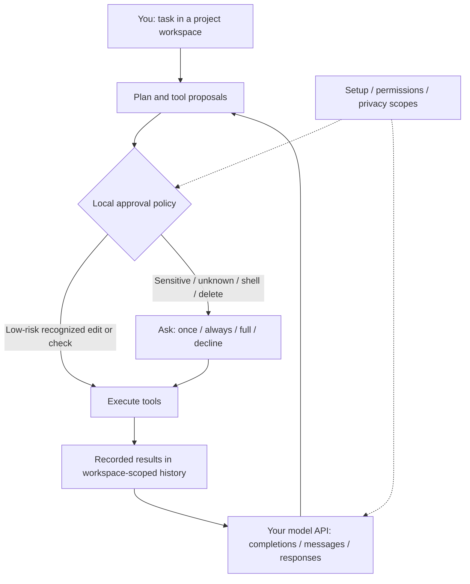
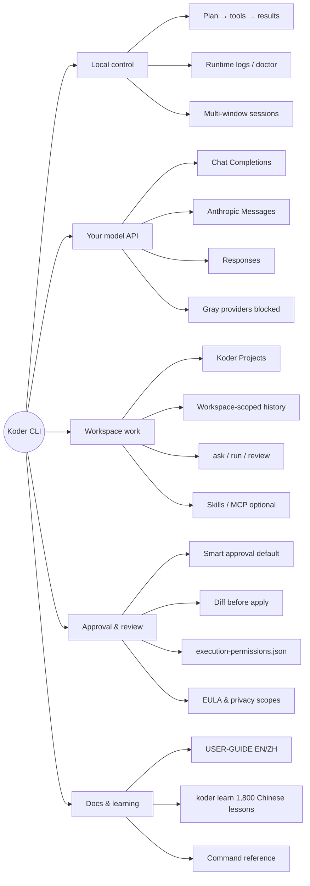
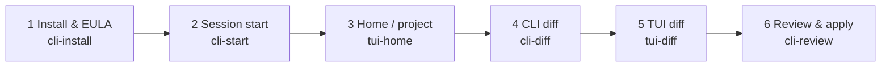

# Koder CLI

[Ubuntu 26.04.1 Desktop amd64 walkthrough](docs/UBUNTU-26.04.md)

## Open Koder after installation

Ubuntu / macOS: run these in the system terminal. Skip setup if the model is already configured.

```bash
"$HOME/.local/bin/koder" setup
"$HOME/.local/bin/koder"
```

Enter tasks only after `koder >` appears. `activate` enables a background service; it does not open chat. If the full path works but `koder` does not, follow the [PATH walkthrough](docs/UBUNTU.md) rather than downloading again. Use the actual installer path for custom installations.


**Current release: 0.5.20. Exact file delivery, evidence-linked local learning, bounded output recovery and opt-in local code repair.**

[Local repair guide](docs/SELF-REPAIR.md) · [Chinese walkthrough](docs/SELF-REPAIR.zh.md) · [Repair permission](LOCAL-REPAIR-PERMISSION.md)

Local code repair is off by default and supports seven feature modules. Windows/Linux native repair checks and the original ten-question acceptance target remain outstanding; see the release evidence.

[Mail setup and recovery](docs/MAIL-RECOVERY.en.md)

[Features and tutorials](docs/FEATURES.md) · [Latest changes](docs/RELEASE-0.5.20.md) · [Session recovery](docs/SESSION-RECOVERY.en.md) · [Windows recovery walkthrough](docs/WINDOWS-DISK-RECOVERY.zh.md)

[Credential setup and login](docs/CREDENTIALS.md) · [Ubuntu tutorial](docs/UBUNTU.md) · [All-platform installation](docs/INSTALLATION.md) · [Start here](docs/START-HERE.en.md) · [Download packages](https://github.com/KarmenLoop/koder-cli/releases/tag/cli-0.5.20) · [中文 Ubuntu 教程](docs/UBUNTU.zh.md)

| Your next step | Guide |
| --- | --- |
| Install on Ubuntu 24.04 / 24.04.x | [Download, progress, model setup and first task](docs/UBUNTU.md) |
| Operate Ubuntu graphical apps | [Desktop dependencies, grants and an editor exercise](docs/UBUNTU.md#7-set-up-and-test-the-graphical-desktop) |
| Troubleshoot a download or waiting task | [Ubuntu troubleshooting](docs/UBUNTU.md#10-troubleshooting) |
| Install or update Windows / macOS | [Choose the matching terminal](docs/INSTALLATION.md) |
| Follow the course | [English course](docs/courses/README.en.md) · [1,800 Chinese lessons](docs/courses/README.zh.md) |


[English](README.md) · [简体中文](README.zh-CN.md) · **v0.5.20**

[](https://github.com/KarmenLoop/koder-cli/releases/tag/cli-0.5.20)
[](https://github.com/KarmenLoop/koder-cli/actions/workflows/windows-installer.yml)
[](https://nodejs.org/)
[](EULA.md)
[](docs/INSTALLATION.md)

**A terminal coding agent that plans, proposes, and applies work on your machine—with your own model API, workspace-isolated history, and local approval before sensitive changes.**

Koder CLI is a **local task tool** from the [KARMEN LOOP](https://karmenloop.com) team. Bring your own provider key or supported local model, choose a project, and work through plans, tools, approvals, and recorded results. **Personal, noncommercial local use is free and does not require membership or an invite code.** Commercial use and organizational deployment need separate written authorization. Providers may charge for API requests.

Current release: **[0.5.20](https://github.com/KarmenLoop/koder-cli/releases/tag/cli-0.5.20)** · Agreement: **[Koder-EULA-1.1](EULA.md)** · Installation: [GitHub guide](docs/INSTALLATION.md)

> Upgrading from 0.4.4 or earlier: if an older updater rejects the larger package, run the current official installer once. Configuration and history are retained. [Installation and migration](docs/INSTALLATION.md).



*0.5.3 startup output captured from an isolated macOS PTY and rendered from ANSI. Font rendering varies by terminal.*

[Download 0.5.20](https://github.com/KarmenLoop/koder-cli/releases/tag/cli-0.5.20) · [Installation](docs/INSTALLATION.md) · [English guide](docs/USER-GUIDE.en.md) · [Chinese guide](docs/USER-GUIDE.zh.md) · [Release notes](docs/RELEASE-0.5.20.md) · [Command reference](docs/COMMAND-REFERENCE.en.md)

---

<details>
<summary>Recent release notes</summary>

> 0.5.12 fixes premature timeouts while waiting for model responses, shows download progress, and corrects broad file-scope access checks. All bundled capabilities remain available. See [release notes](docs/RELEASE-0.5.12.md).

> 0.5.10 uses smaller macOS and Linux downloads with resumable, checksum-verified installation. Supported runtime features, bundled Skills and the complete current classroom remain included. The full offline archive is still available. See [download and recovery instructions](docs/DOWNLOADS.md).

> 0.5.9 loads the bundled learning method by default, supplies typed learning examples, and keeps the native delivery checker available when a task resumes. [Release notes](docs/RELEASE-0.5.9.md) · [Learning controls](docs/MARKDOWN-LEARNING.en.md).

> 0.5.8 restores pending background mail reminders, reports uncertain sends as incomplete, and records terminal layout choices. [Release notes](docs/RELEASE-0.5.8.md) · [Mail guide](docs/MAIL-RECOVERY.en.md). [Ubuntu full-runtime guide](docs/UBUNTU.md).

> 0.5.7 fixes mailbox ownership and send recovery, refreshes inbox reads, and corrects website delivery checks. [Release notes](docs/RELEASE-0.5.7.md) · [Mail guide](docs/MAIL-RECOVERY.en.md).

> 0.5.6 improves task completion and website handoff: explicit incomplete results, bounded recovery, current file evidence and a real preview address. [Release notes](docs/RELEASE-0.5.6.md) · [Website workflow](docs/website-delivery.md).

> 0.5.5 saves local Markdown task memory by default and reviews it during CLI sessions or the next task. Existing off choices remain off; use Setup or `koder learning off` for the feature and `koder growth off` for the master switch. [Release notes](docs/RELEASE-0.5.5.md) · [Task memory guide](docs/MARKDOWN-LEARNING.en.md).

> 0.5.4 adds model-specific thinking controls, preserves truncated answers, and keeps child-task effort settings consistent. [Release notes](docs/RELEASE-0.5.4.md) · [Thinking and output guide](docs/MODEL-EFFORT-AND-OUTPUT.en.md).

> 0.5.3 refines the startup refractor and gives Setup and pickers slimmer blue frames, with better narrow-terminal sizing and reduced-motion support. [Release notes](docs/RELEASE-0.5.3.md) · [Terminal guide](docs/SESSION-DOCK.en.md#startup-and-frame-appearance).

> 0.5.2 adds native JS/TS source navigation and capability routing, and repairs MCP alias handling and optional-service discovery. [Capability guide](docs/NATIVE-MCP-CAPABILITIES.en.md) · [Release notes](docs/RELEASE-0.5.2.md).

> 0.5.0 adds bundled offline OCR, professional child-task roles, bounded child concurrency and explicit headless task results. [Release notes](docs/RELEASE-0.5.0.md).

[Start here: installation, updates and all workflows](docs/START-HERE.en.md)

</details>

## Why this exists

Most terminal agents either hide what they will change, or treat every model suggestion as permission. Teams that already pay for model APIs should not need a second membership gate just to run a local client—and they should see **what will run** before sensitive edits, deletes, or shell effects land.

Koder keeps four things deliberate:

1. **Your model, your bill** — Chat Completions, Anthropic Messages, and Responses; catalog entries show current availability next to historical references. A website subscription is never assumed to be API access.
2. **Local control plane** — planning, permission checks, tool execution, and saved results stay on your machine under the KARMEN LOOP kernel narrative. Execution grants are hashed and scoped; they are not synchronized as “memory.”
3. **Smart approval by default** — recognized low-risk local checks and ordinary project edits can proceed; code execution, deletion, secret paths, shell effects, unknown commands, and external app actions ask. The decision comes from **local policy code**, not a model’s claim.
4. **Honest boundaries** — gray provider rows stay unselectable; native Windows GUI / ConPTY / real mailbox / model-quality paths that were not run stay labeled **NOT_RUN** in release evidence.

It does **not** claim that local fixtures certify every PC, provider account, or model quality score.

---

## Snapshot

| | |
|---|---|
| **What you install** | Versioned CLI runtime via official Windows / macOS / Linux installers (Node **^22.21.0 or ≥24**, reused or downloaded and checksum-verified) |
| **What you bring** | Your own model API key or a supported local model endpoint |
| **Version** | **0.5.20** (`RELEASE.json`, release tag `cli-0.5.20`, stable channel) |
| **License for this build** | **Koder-EULA-1.1** — proprietary end-user license for the current application runtime |
| **Personal use** | Free for personal, noncommercial local use — **no membership, no invite code** |
| **Commercial / org** | Separate prior written authorization (`koder business` / [commercial licensing](docs/COMMERCIAL-LICENSING.md)) |
| **Projects** | New website / slides / app work uses **Koder Projects** folders unless `-w` or an existing workspace is set |
| **History** | Task history and automatic facts are **workspace-scoped**; `default` means default session *of that workspace* |
| **Task memory** | Local Markdown records are on by default, scoped by account, workspace and task session; inspect with `koder learning status`, pause with `koder learning off` |
| **Learning coach** | `koder learn` — 1,800 Chinese lessons , with the original 30 English lessons retained; hands-on and developer tracks; **no paid model required to read** |
| **Optional depth** | Portable Skills, Harness profiles, residency, mail inquiry, Windows-MCP / Code Graph presets, celebrations |
| **Public GitHub tree** | Retains historical **GPL 0.3.1** source; that tree **does not** build this proprietary installer ([source status](SOURCE-STATUS.md)) |

---

## Is / Is not

| Is | Is not |
|---|---|
| Local **terminal coding agent** with BYO model API | Hosted coding SaaS or bundled paid model quota |
| Free personal noncommercial local use without membership | Permission for commercial / organizational deployment without written auth |
| Smart approval + diff-oriented review before sensitive apply | Operating-system sandbox or admin elevation |
| Workspace-isolated task history and project folders | One global chat that mixes every repo’s facts |
| Official installers with SHA-256 verification and EULA `accept` step | Silent license accept via empty Enter (empty input asks again) |
| Grayed, blocked routes for known broken provider integrations | Silent billing-route switch or automatic “backup engine” fallback |
| Documented NOT_RUN limits for native Windows / real accounts | Claim that macOS fixtures certify Windows GUI or model quality |
| Supported config / skills / MCP extension points | Right to modify or redistribute proprietary runtime source |
| Fail-closed execution records (`execution-permissions.json`) | Permission restored from a damaged or partial grant file |
| Opt-in residency, mail, remote resources, celebrations | Capabilities enabled merely by accepting the EULA |

---

## Architecture

Three layers stay separate on purpose. The model proposes; the local policy decides; the workspace records.

1. **Client & session** — interactive chat, editable `/` prompt choices, mid-run steer-or-queue, multi-window task sessions, and bounded private runtime logs (`koder logs`, doctor). Queued text cannot approve a pending sensitive prompt.
2. **Control plane** — plan → local permission policy → tool execution → recorded results. Grants are action-hashed and scoped to a workspace (or an explicit profile with confirm). They live under the local CLI home as `execution-permissions.json` and are **not** synced as conversation memory.
3. **Your model & tools** — Chat Completions, Anthropic Messages, or Responses on endpoints you configure. Optional MCP / Skills / apps attach only after their own setup and approvals. Protocol compatibility does not certify every third-party service.



**Isolation note.** The session label `default` means the default session **of that canonical workspace**, not one global conversation across every folder. Private transcripts live in the user Koder profile, indexed by workspace and session—not inside a public site output directory.

---

## Product mind map

How the pieces fit together at a glance—control stays local; the model is yours; sensitive apply waits for approval.



---

## Screenshot roadmap

Six real captures from `docs/screenshots/`, ordered as a first-success path. The [Guided walkthrough](#guided-walkthrough) embeds each image under its step—hero stays lean on purpose.



| Step | What you do | Screenshot |
|---|---|---|
| 1 | Run the installer and type `accept` at the EULA prompt | [`cli-install-en-dark.jpg`](docs/screenshots/cli-install-en-dark.jpg) |
| 2 | Reopen the terminal, verify version, enter a session | [`cli-start-en-dark.jpg`](docs/screenshots/cli-start-0.5.3-en-dark.png) |
| 3 | Finish `koder setup`, open a project / TUI home | [`tui-home-en-dark.jpg`](docs/screenshots/tui-home-en-dark.jpg) |
| 4 | Give a first task; inspect the proposed CLI diff | [`cli-diff-en-dark.jpg`](docs/screenshots/cli-diff-en-dark.jpg) |
| 5 | Optionally review the same change in the TUI diff view | [`tui-diff-en-dark.jpg`](docs/screenshots/tui-diff-en-dark.jpg) |
| 6 | Approve or decline; run `koder review` when you want a structured pass | [`cli-review-en-dark.jpg`](docs/screenshots/cli-review-en-dark.jpg) |

---

## Capabilities at a glance

| Area | What you get | Where it stops |
|---|---|---|
| **Chat & Agent** | Interactive `koder`, `ask`, `run`, modes, `/` editable choices, mid-run steer or queue | Modes are not permission grants; queued text cannot approve a pending prompt |
| **Projects** | `koder project create|list|status`, `/project`, Koder Projects home | Does not scatter project files into the program install directory |
| **Delivery checks** | Current-turn artifact / format / receipt checks with bounded repair | Not a coding or writing quality score ([TASK-DELIVERY](docs/TASK-DELIVERY.en.md)) |
| **Visual workflow** | Three HTML directions before full build; companion `/preview`; H5 atlas at handoff | Browser prototype ≠ native device acceptance ([VISUAL-WORKFLOW](docs/VISUAL-WORKFLOW-AND-NETLIFY.md)) |
| **Skills & MCP** | Portable skills, catalog/read on demand, compatibility inventory | Protocol compatibility ≠ every third-party service certified ([inventory](docs/MCP-SKILL-INVENTORY.md)) |
| **Growth method** | Default native `personal-agent-growth` 0.4.3 method; `koder growth status|show|on|off` | No profiling sync, background service, or new API budget by default ([guide](docs/AUTONOMOUS-LEARNING.md)) |
| **Residency & mail** | Opt-in `koder activate` / `status` / `deactivate`; mail inquire → draft → confirm send | Off by default; ads/OTP excluded ([ALWAYS-ON](docs/ALWAYS-ON.en.md)) |
| **Windows depth** | Optional Windows-MCP + Code Graph presets; bundled x64 runtime on Windows packages | GUI / cold-install paths may remain NOT_RUN ([MCP-INTEGRATIONS](docs/MCP-INTEGRATIONS.en.md)) |
| **Celebrations** | Optional `koder celebrate` effects; reduced-motion respected | License accept does not enable birthday, music, or geo lookup |

---

## Install

Use **Windows 10/11**, **macOS**, **Linux**, or **WSL** with the matching shell. Normal installation does **not** require administrator access. Read the [EULA](EULA.md), [acceptance guide](ACCEPTANCE.md), [legal notice](LEGAL-NOTICE.md), and [CLI privacy](docs/privacy/consumer-privacy.en.md) before typing `accept`.

Choose **one** command. Wait for `accept / decline:`, type `accept`, press Enter. `decline` or Ctrl+C cancels. Empty Windows input asks again — it does **not** accept. License acceptance enables **no** optional computer, mail, profile-learning, sync, birthday, music, or country-lookup permissions.

The matching screenshot lives in [walkthrough step 1](#1-install-and-accept-the-eula).

### Windows PowerShell

```powershell
$ErrorActionPreference='Stop'; $ProgressPreference='SilentlyContinue'; [Net.ServicePointManager]::SecurityProtocol=[Net.ServicePointManager]::SecurityProtocol -bor [Net.SecurityProtocolType]::Tls12; $u='https://github.com/KarmenLoop/koder-cli/releases/download/cli-0.5.20/koder-cli.ps1'; Write-Host ('Koder: loading installer from '+([Uri]$u).Host+'...'); $limit=100000000; if($env:KODER_DOWNLOAD_TIMEOUT_SECONDS){$v=0; if([int]::TryParse($env:KODER_DOWNLOAD_TIMEOUT_SECONDS,[ref]$v) -and $v -ge 1 -and $v -le 100000000){$limit=$v}else{throw 'KODER_DOWNLOAD_TIMEOUT_SECONDS must be 1..100000000'}}; $connect=30; if($env:KODER_DOWNLOAD_CONNECT_TIMEOUT_SECONDS){$v=0; if([int]::TryParse($env:KODER_DOWNLOAD_CONNECT_TIMEOUT_SECONDS,[ref]$v) -and $v -ge 1 -and $v -le 3600){$connect=$v}else{throw 'KODER_DOWNLOAD_CONNECT_TIMEOUT_SECONDS must be 1..3600'}}; $bootstrapLimit=[Math]::Min($limit,$connect); $client=New-Object Net.WebClient; $client.Encoding=[Text.Encoding]::UTF8; $clock=[Diagnostics.Stopwatch]::StartNew(); $next=5; try{$task=$client.DownloadStringTaskAsync([Uri]$u); $wait=([IAsyncResult]$task).AsyncWaitHandle; while(-not $wait.WaitOne(200)){if($clock.Elapsed.TotalSeconds -ge $bootstrapLimit){if($limit -le $connect){throw ('Installer download timed out after '+$limit+'s')}; throw ('Installer bootstrap stalled after '+$connect+'s')}; if($clock.Elapsed.TotalSeconds -ge $next){Write-Host ('Still loading installer: '+[int]$clock.Elapsed.TotalSeconds+'s elapsed. Ctrl+C cancels.'); $next+=5}}; $script=$task.GetAwaiter().GetResult()}finally{$client.CancelAsync(); $client.Dispose()}; Invoke-Expression $script
```

### Windows Command Prompt (CMD)

Paste the complete line at a **CMD** prompt (not into PowerShell):

```bat
powershell -NoProfile -ExecutionPolicy Bypass -Command "$ErrorActionPreference='Stop'; $ProgressPreference='SilentlyContinue'; [Net.ServicePointManager]::SecurityProtocol=[Net.ServicePointManager]::SecurityProtocol -bor [Net.SecurityProtocolType]::Tls12; $u='https://github.com/KarmenLoop/koder-cli/releases/download/cli-0.5.20/koder-cli.ps1'; Write-Host ('Koder: loading installer from '+([Uri]$u).Host+'...'); $limit=100000000; if($env:KODER_DOWNLOAD_TIMEOUT_SECONDS){$v=0; if([int]::TryParse($env:KODER_DOWNLOAD_TIMEOUT_SECONDS,[ref]$v) -and $v -ge 1 -and $v -le 100000000){$limit=$v}else{throw 'KODER_DOWNLOAD_TIMEOUT_SECONDS must be 1..100000000'}}; $connect=30; if($env:KODER_DOWNLOAD_CONNECT_TIMEOUT_SECONDS){$v=0; if([int]::TryParse($env:KODER_DOWNLOAD_CONNECT_TIMEOUT_SECONDS,[ref]$v) -and $v -ge 1 -and $v -le 3600){$connect=$v}else{throw 'KODER_DOWNLOAD_CONNECT_TIMEOUT_SECONDS must be 1..3600'}}; $bootstrapLimit=[Math]::Min($limit,$connect); $client=New-Object Net.WebClient; $client.Encoding=[Text.Encoding]::UTF8; $clock=[Diagnostics.Stopwatch]::StartNew(); $next=5; try{$task=$client.DownloadStringTaskAsync([Uri]$u); $wait=([IAsyncResult]$task).AsyncWaitHandle; while(-not $wait.WaitOne(200)){if($clock.Elapsed.TotalSeconds -ge $bootstrapLimit){if($limit -le $connect){throw ('Installer download timed out after '+$limit+'s')}; throw ('Installer bootstrap stalled after '+$connect+'s')}; if($clock.Elapsed.TotalSeconds -ge $next){Write-Host ('Still loading installer: '+[int]$clock.Elapsed.TotalSeconds+'s elapsed. Ctrl+C cancels.'); $next+=5}}; $script=$task.GetAwaiter().GetResult()}finally{$client.CancelAsync(); $client.Dispose()}; Invoke-Expression $script"
```

### Ubuntu 24.04 LTS (dedicated installer)

With wget installed, paste this complete line. The installer runs only if its download succeeds:

```bash
wget --tries=3 --timeout=30 -O /tmp/koder-ubuntu-install.sh https://github.com/KarmenLoop/koder-cli/releases/download/cli-0.5.20/koder-ubuntu-24.04.sh && bash /tmp/koder-ubuntu-install.sh
```

Use the [Ubuntu walkthrough](docs/UBUNTU.md#2-choose-one-installation-route) for curl or missing download tools. Installation reports MB, percentage and elapsed time, and supports resuming interrupted transfers. Open a new terminal afterward and run `koder --version` and `koder setup`. Desktop operations need separate dependencies and permission.

### macOS / Linux / WSL

```sh
curl -fsSL https://raw.githubusercontent.com/KarmenLoop/koder-cli/main/install/koder-cli.sh | bash
```

Downloads show progress and verify SHA-256. Reopen the terminal after success, then:

```text
koder --version
koder setup
```

`koder --version` should report **0.5.20**. Full platform notes: [Installation](docs/INSTALLATION.md).

---

## Start working

After install and a fresh terminal:

```text
koder setup
koder learn
koder
```

- `koder setup` — connect your model API (required before real tasks).
- `koder learn` — 1,800-lesson Chinese course with the original 30-lesson practice coach; **no paid model required to read**.
- `koder` — interactive chat in the current workspace.

Prefer a scripted first success? Follow the [Guided walkthrough](#guided-walkthrough) below.

---

## Guided walkthrough

A first-success path from zero to a conscious approve-or-decline. Deeper workflows (projects, preview, Netlify, mail, residency) live in the [English user guide](docs/USER-GUIDE.en.md) and [Chinese user guide](docs/USER-GUIDE.zh.md)—this section alone is enough to install, configure, run one task, read the diff, and decide.

### 1. Install and accept the EULA

1. Pick **one** installer command from [Install](#install) above (PowerShell, CMD, or macOS/Linux/WSL).
2. Wait until progress finishes and the prompt shows exactly: `accept / decline:`.
3. Type `accept` and press Enter. Type `decline` or press Ctrl+C to cancel. On Windows, an empty Enter **asks again**—it does not accept.
4. When the installer finishes, **close and reopen** the terminal so `PATH` refreshes.


*Step 1 — installer progress and the EULA prompt. Acceptance enables no optional computer, mail, sync, or celebration extras.*

### 2. Confirm the binary and open a session

```text
koder --version
koder
```

Expect **0.5.20**. Bare `koder` opens interactive chat. Prefer a short coach first?

```text
koder learn
```

`Enter` continues a lesson, `b` goes back, `q` leaves. Offline text editions: `koder learn --print --os mac --lang en` (also `powershell` / `cmd` / `linux`; `--lang zh` for Chinese).


*Step 2 — session start after a clean install.*

### 3. Configure your model API and pick a project

```text
koder setup
```

In setup:

1. Choose an **available** (non-gray) provider entry.
2. Enter the exact model ID, protocol, and endpoint your account issues.
3. Prefer an environment-variable key reference when you do not want the key value stored in the profile; never paste a key into a task, screenshot, or issue.
4. A website subscription is **not** automatically API access.

Then create or select a project. New website / slides / app work defaults to **Koder Projects** under your home directory unless you pass `-w` or continue an existing workspace:

```text
koder project create "Studio Site" --kind website
koder project create "Quarterly Review" --kind slides
koder project create "Studio App" --kind app
koder project list --json
koder project status
koder chat -w /absolute/path/to/existing-project
```

Inside chat: `/project create "Another Site" --kind website` creates and selects; `/project open "/absolute/path"` returns to an existing folder. Name collisions are rejected—files are not merged.


*Step 3 — TUI home after setup; confirm the workspace before the first real task.*

Smoke-test the provider when ready (these calls may incur provider charges):

```text
koder model presets
koder model test
koder model test --tools
```

`model test` uses a short diagnostic budget; a text reply proves text access only. `--tools` requests a harmless tool round-trip and continuation.

### 4. Run a first task and read the CLI diff

In chat, type a concrete, bounded ask—for example: explain a file, add a short README note, or repair a failing local check. Or from the shell:

```text
koder ask "Explain the architecture of this project" --lang en
koder run "Add a short note to README about local setup" --lang en
```

| Command | Behavior |
|---|---|
| `ask` | Answers **without** proposing file edits |
| `run` | May propose tools under the approval policy |
| `--mode plan\|code\|execute\|…` | Work **modes**, not permission grants |
| `--session name` | Named session **inside this workspace** |
| `--new` / `--no-memory` | Fresh topic / no saved task history for this call |

When the agent proposes project edits, **read the CLI diff before you approve**:

1. Paths — are they inside the intended project?
2. Deletions — intentional, or collateral?
3. Secrets / config — anything near keys, `.env`, credentials, or deploy config?
4. Scope — does the hunk match the ask, or drift into unrelated files?


*Step 4 — CLI diff-oriented review. Approval policy, not an OS sandbox.*

### 5. Optional: review the same change in the TUI

If you prefer a full-screen view, open the TUI diff for the pending change. Captions and hunks match the CLI story—same workspace, same policy. Approve or decline with equal care.


*Step 5 — TUI diff of a proposed change.*

### 6. Approve or decline — then optionally run review

At a sensitive prompt:

| Input | Effect |
|---|---|
| **y** | Allow **this** action once |
| **a** / `always` | Save that **exact** action for this workspace |
| **f** / `full` | Full access for this workspace (or `--scope profile` with explicit confirm) |
| Enter / **n** | Decline |

Decline is a first-class outcome. An unknown result is not success—verify state before retrying a send, payment, or deployment.

After you accept, the change lands in workspace-scoped history. For a structured review pass:

```text
koder review
koder review --format json
```

Use `koder review` when you want findings after apply, before a larger follow-up, or when a CI-style gate should distinguish a clean parse from failure. If a successful model answer still cannot be parsed into complete findings, the CLI exits **3** with `REVIEW_UNPARSED`—do **not** treat that as a clean review.


*Step 6 — review / fix loop after apply.*

**First success** means: version reports 0.5.20, setup has a working (non-gray) provider, one task produced a readable diff, and you consciously approved or declined. For multi-window sessions, Skills/MCP, residency, and mail inquiry, continue in the [user guide](docs/USER-GUIDE.en.md).

Day-to-day chat: type `/` on an empty prompt for editable choices (Tab fills, Esc closes, Enter sends only after fill). `/setup` opens settings, `/model` manages models, `/new` starts a topic, `/exit` leaves. `/menu` opens settings; Escape leaves.

---

## Safety: approvals, diffs, and permissions

Smart approval is the default: recognized low-risk local checks and ordinary project edits can proceed without a question. Code execution, deletion, secret or configuration paths, shell effects, unknown commands, and external application actions **ask**. The decision is computed by local policy code—not by trusting the model’s description of risk.

This is an **approval policy**, not an OS sandbox. It does not elevate privileges, bypass accessibility prompts, or replace your provider’s security model.

At a sensitive prompt: **y** once, **a** / always for that exact action in this workspace, **f** / full for this workspace (or `--scope profile` with explicit confirm), Enter / **n** to decline.

```sh
koder permissions execution status
koder permissions execution ask
koder permissions execution auto
koder permissions execution full --confirm FULL
koder permissions execution full --scope profile --confirm FULL
koder permissions execution revoke all
koder permissions execution reset
```

| Control | Scope |
|---|---|
| `ask` / `auto` / `full` | Persistent execution policy for the workspace (or profile with confirm) |
| `revoke all` | Return this workspace to smart mode; remove applicable saved rules |
| `reset` | Remove all saved execution settings |
| `--approval auto\|ask\|full\|deny` | **Current run only** |
| `--yes` | Temporary convenience; **cannot** override explicit deny, accept the EULA, supply passwords, or grant OS accessibility |

Rules live under the local CLI home as `execution-permissions.json` (host/workspace scope + action hashes—not raw commands or keys). Damaged records **fail closed**: Koder offers a fresh decision; they do not silently restore broad access. Execution authority is not synchronized as memory.

Privacy and feedback stay offline-readable:

```text
koder privacy consumer
koder privacy statement
koder privacy desktop
koder privacy agreement
koder privacy sources
koder feedback
koder permissions status
```

`koder feedback` opens a blank template for **info@karmenloop.com** — nothing is sent or attached automatically. Strip keys, passwords, private paths, and personal records before you send.

---

## Models and providers

Configure in `koder setup` or with explicit profile commands. Keep three boundaries clear:

1. **Billing** — Koder does not replace your provider’s billing. Website membership ≠ API access.
2. **Protocols** — Chat Completions, Anthropic Messages, and Responses. Catalog rows may show historical references; **current availability** is shown next to each entry.
3. **No silent fallback** — independent plan entries keep independent hosts, keys, and billing routes. The internal backup engine stays disabled and gray by default.

```text
koder model presets
koder model models aliyun-coding-plan
koder model test
koder model test --tools
koder model set --model ACTUAL_MODEL_ID --base-url OFFICIAL_API_BASE --protocol openai --key-env MY_PROVIDER_KEY
```

See [PROVIDERS.md](docs/PROVIDERS.md) and [MIMO.md](docs/MIMO.md) for endpoints and safe setup.

**Temporarily unavailable (gray, blocked before network):** MiMo Token Plan, Kimi API, Kimi Code, DeepSeek, Alibaba Token Plan, Volcano Coding Plan, and Volcano Ark API. Existing profiles remain for view/remove; activation, test, refresh, and execution stay blocked. No automatic billing-route switch.

---

## Skill discovery and delegated tasks

Remote Skill discovery now preserves repository-qualified searches such as `repo:anthropics/skills`. Candidates remain pinned to commits and verified file hashes. The original tool loop can fetch and read a Skill, then continue the unfinished task under existing permissions. Task rounds remain unlimited by default; optional cost budgets and cancellation still apply to the parent and its children.

[Hands-on guide](docs/SELF-FETCH-AND-SUBAGENTS.en.md) · [中文操作教程](docs/SELF-FETCH-AND-SUBAGENTS.zh.md) · [Evidence and retained limits](docs/ORCHESTRATION-ACCEPTANCE.md).

## AI application workflows

Awesome LLM Apps is enabled by default for relevant AI-app, RAG and agent-team tasks. Search 146 pinned examples, inspect their actual source, and build through the existing Koder provider, tools and approvals. Seven adapted methods cover reviews, history, dependencies and delegation. Local retrieval and quote checks operate on explicitly named project files.

```text
koder llm-apps status
koder llm-apps list --query RAG
koder llm-apps plan rag_tutorials/rag_chain
koder llm-apps retrieve policy.md --query "returns" --json
```

[Hands-on guide](docs/AWESOME-LLM-APPS.en.md) · [中文教程](docs/AWESOME-LLM-APPS.zh.md) · [Full catalog](docs/AWESOME-LLM-APPS-CATALOG.md). Disable it with `koder llm-apps off` or Setup → Skills. Bundled examples are reference source; their cloud accounts, Python/Node dependencies and UIs are not automatically installed or certified.

## SolidCraft CAD

```sh
mkdir -p "$HOME/Koder Projects/plate"
cd "$HOME/Koder Projects/plate"
koder cad enable
koder cad verify
koder cad test
koder
```

Ask for a dimensioned part, a measured volume, an editable `.solidcraft` design and the required STEP/STL/PNG outputs. Reopen the saved design explicitly in later turns. [English tutorial](docs/SOLIDCRAFT.en.md) · [中文手把手教程](docs/SOLIDCRAFT.zh.md). Native Windows and Intel Mac runs remain beta acceptance; the Apple-silicon check uses real CAD tools with a scripted model.

## Previous release: 0.4.19

SolidCraft 0.23.0 is bundled for Windows x64 and macOS Apple silicon/Intel. Enable it per project with `koder cad enable`, check the connection with `koder cad test`, and use the built-in Skill to model, measure, save and export. Every turn receives an isolated headless design through the existing Core; CAD delivery checks use files and measurements rather than software-test requirements. Existing mail, Skills, unlimited task rounds, cancellation and cost budgets remain. Read the [hands-on CAD guide](docs/SOLIDCRAFT.en.md) and [release notes](docs/RELEASE-0.4.19.md).

## Private collections and company licensing

Remote references stay **off** by default. Opt in per command with `koder resources search "keywords" --remote`, or set `KODER_REMOTE_RESOURCES=1` for agent-visible remote tools (`0` forces off). Import local archives with `koder resources import` — originals stay local; see [REMOTE-RESOURCES](docs/REMOTE-RESOURCES.md) and [PRIVATE-RESOURCES](docs/PRIVATE-RESOURCES.md).

For company licensing and dedicated private repository delivery: `koder business` or [info@karmenloop.com](mailto:info@karmenloop.com). A separate written agreement defines scope; stars and inquiry emails alone are not authorization ([COMMERCIAL-LICENSING](docs/COMMERCIAL-LICENSING.md)).

---

## Updates

Eligible managed interactive chats check the official update feed at startup and periodically every six hours and install only when tasks, queues, and drafts are clear. A changed license requires manual review.

```text
koder update --check
koder update
koder update auto status
koder update auto off
koder update auto on
```

`KODER_AUTO_UPDATE=0` disables automatic checks for that process. Scripts and one-shot commands do not auto-install. Details: [AUTO-UPDATE](docs/AUTO-UPDATE.en.md).

---

## Docs map

| Need | Start here | Why it exists |
|---|---|---|
| Install & first model | [INSTALLATION.md](docs/INSTALLATION.md) | Platform shells, Node reuse/download, EULA accept, recovery |
| Complete workflows (EN / ZH) | [USER-GUIDE.en.md](docs/USER-GUIDE.en.md) · [USER-GUIDE.zh.md](docs/USER-GUIDE.zh.md) | End-to-end product narrative beyond first success |
| Every documented command | [COMMAND-REFERENCE.en.md](docs/COMMAND-REFERENCE.en.md) · [zh](docs/COMMAND-REFERENCE.zh.md) | Generated reference for flags and subcommands |
| Providers & protocols | [PROVIDERS.md](docs/PROVIDERS.md) | Endpoints, gray routes, safe key handling |
| Live input, steer/queue, skills UI | [SESSION-INPUT-AND-SKILLS](docs/SESSION-INPUT-AND-SKILLS.en.md) | Busy-time input and on-demand skill loading |
| Scriptable contracts & exit codes | [CLI-CONTRACTS.md](docs/CLI-CONTRACTS.md) | Stdin, clarification, approvals, nonzero meanings |
| Multi-window sessions | [MULTI-WINDOW.md](docs/MULTI-WINDOW.md) | Independent terminal task sessions |
| Residency / mail inquiry | [ALWAYS-ON](docs/ALWAYS-ON.en.md) · [MAIL-PROACTIVE-INQUIRY](docs/MAIL-PROACTIVE-INQUIRY.en.md) | Opt-in always-on and mail draft → confirm send |
| MCP / Skill inventory | [MCP-SKILL-COMPATIBILITY](docs/MCP-SKILL-COMPATIBILITY.en.md) · [inventory](docs/MCP-SKILL-INVENTORY.md) | Switches, deps, verified limits—not a certification of every SaaS |
| Local task memory (on by default) | [MARKDOWN-LEARNING.en.md](docs/MARKDOWN-LEARNING.en.md) | Scoped Markdown records, effective settings, review and opt-out |
| Autonomous learning method (bundled) | [AUTONOMOUS-LEARNING.md](docs/AUTONOMOUS-LEARNING.md) | How `personal-agent-growth` attaches without new budgets |
| Troubleshooting | [TROUBLESHOOTING.md](docs/TROUBLESHOOTING.md) | Stalled install, gray providers, common failures |
| Distribution & legacy GPL tree | [DISTRIBUTION.md](DISTRIBUTION.md) · [SOURCE-STATUS.md](SOURCE-STATUS.md) | Proprietary runtime vs historical public tree |
| Printable course texts | [docs/tutorials/](docs/tutorials/) | 1,800 Chinese / 30 English lessons across PowerShell, CMD, macOS and Linux editions |
| This release | [RELEASE-0.5.20.md](docs/RELEASE-0.5.20.md) | What changed and what remains NOT_RUN |

---

## Validation honesty

Release evidence distinguishes **source / fixture checks**, **installed protocol fixtures**, **hosted native Windows**, **real provider accounts**, and **user devices**. Local no-key regressions exercise CLI behavior with scripted providers; they do **not** certify PowerShell 5.1 cold install, ConPTY/IME, Windows-MCP GUI operation, mailbox delivery, or model quality. Those items remain **NOT_RUN** where the [0.5.20 notes](docs/RELEASE-0.5.20.md) and [Windows install checks](docs/WINDOWS-INSTALL-CHECKS.md) say so.

Ready-to-use packages, installers, and checksums ship as **release assets**. New tags may add distribution documentation without publishing proprietary runtime source to this public tree.

---

## FAQ

**Do I need an invite code or paid membership to install?**  
No. Personal, noncommercial local use is free under Koder-EULA-1.1 and does not require membership. Commercial and organizational use need separate written authorization.

**Whose model API does Koder use?**  
Yours. Configure a provider in setup. Koder does not replace your provider’s billing. Some catalog rows are temporarily gray and blocked (see [Models and providers](#models-and-providers)).

**Will it change my files without asking?**  
Recognized low-risk local checks and ordinary project edits may run under smart approval. Sensitive or unknown effects—including deletion, secret paths, and shell side effects—ask first. Review diffs and targets before approving.

**Is the public GitHub source the 0.5.20 runtime?**
No. The public tree keeps historical GPL **0.3.1** material for continuity. The **0.5.20** application runtime is proprietary and distributed via the official installer and release feed ([SOURCE-STATUS.md](SOURCE-STATUS.md)).

**Can my company deploy it?**  
Contact [info@karmenloop.com](mailto:info@karmenloop.com) or run `koder business`. Stars, downloads, and inquiry emails alone are not commercial authorization.

**Where do projects and private history live?**  
New creation tasks default to **Koder Projects** under your home directory unless you pass `-w` or continue an existing workspace. Private conversation records stay in the user Koder profile, indexed by workspace and session—not inside a public site output folder.

**When should I run `koder review`?**  
After apply when you want structured findings, before a larger follow-up, or when a gate must distinguish a clean parse from `REVIEW_UNPARSED` (exit 3). It is not a substitute for reading the diff before the first approve.

**Where is the hand-holding tutorial?**  
On this page: [Guided walkthrough](#guided-walkthrough) (with all six screenshots). Full depth: [USER-GUIDE.en.md](docs/USER-GUIDE.en.md) · [USER-GUIDE.zh.md](docs/USER-GUIDE.zh.md) · `koder learn`.

---

## License and contact

- Current distribution: **[EULA.md](EULA.md)** (Koder-EULA-1.1) · scope note: [LICENSE](LICENSE)
- Third-party: [THIRD_PARTY_NOTICES.md](THIRD_PARTY_NOTICES.md) · [OPEN_SOURCE_CREDITS.md](OPEN_SOURCE_CREDITS.md) · [licenses/](licenses/)
- Bundled method packages retain their own licenses (for example the unmodified `personal-agent-growth` method remains AGPL-3.0-only where shipped)

KARMENLOOP Official Team · Shanghai, China · [karmenloop.com](https://karmenloop.com) · [info@karmenloop.com](mailto:info@karmenloop.com)

If Koder is useful, an optional [GitHub star](https://github.com/KarmenLoop/koder-cli) helps others find it. Skip freely — stars never affect installation or licensed features.

## Detailed learning paths

Classroom edition **2026.10.26.1** adds 1,800 downloadable practice workbooks, twelve domain guides, and an offline exercise helper. Start with the [hands-on guide](docs/courses/PRACTICE-GUIDE.zh.html) or [download the complete classroom](https://github.com/KarmenLoop/koder-cli/releases/download/cli-0.5.9/koder-academy-0.5.9.zip). This course revision is separate from CLI 0.5.9.

The [1,800-lesson Chinese classroom](docs/courses/index.zh.html) is organized into 120 units, with explanations, examples, exercises, quizzes, troubleshooting and developer guidance. Notes and progress stay in the browser and can be exported. The [original 30 English lessons](docs/courses/README.en.md) and existing practice project remain available. The classroom has shipped since 0.4.12; update the installed CLI to use the added lessons. See the [course guide](docs/courses/ACADEMY-GUIDE.zh.md) for the two learning tracks and local classroom controls.

## Device migration

Version 0.4.12 introduced `koder migrate` to Setup and chat. Export an encrypted
project snapshot, import it into an isolated profile, or send it through an
already configured SSH connection. The destination keeps its existing data and
requires fresh credentials and device permissions. This is a data migration, not
a transfer of running processes.

Read the [step-by-step migration guide](docs/DEVICE-MIGRATION.en.md) or the
[Chinese classroom guide](docs/DEVICE-MIGRATION.zh.md) for supported data, limits,
verification and rollback. Real cross-device Windows and SSH acceptance remains pending; see the release notes.

## Website requirements and design

Build from a clear goal, audience and primary action. Koder now bundles 84 complete DESIGN.md references, asks about missing requirements, records project design decisions and continues through the existing implementation, preview and delivery tools. The method is enabled by default and can be disabled in Setup or with koder design off. [Guide](docs/AWESOME-DESIGN-MD.en.md) · [中文教程](docs/AWESOME-DESIGN-MD.zh.md).

## Website delivery and project anchors

Discuss missing requirements, keep a stable project purpose and build through the existing implementation and preview tools. The original Fullstack Web Delivery 0.9.1 Skill is bundled unchanged and enabled by default. Each new project has its own folder and PROJECT-ANCHOR.md; old-site repairs retain their directory and decisions. [Hands-on guide](docs/WEBSITE-PROJECTS.en.md) · [中文教程](docs/WEBSITE-PROJECTS.zh.md).

## Document questions with PageIndex

Navigate local Markdown, text and PDF trees with the existing Koder model. Read original sections and verify file versions, page/line ranges and exact quotes before answering. The PDF parser ships in the runtime; no Python or new cloud account is required. Enabled by default for document tasks and configurable in Setup. [Hands-on guide](docs/PAGEINDEX.en.md) · [中文教程](docs/PAGEINDEX.zh.md).

## Check capabilities and delegate with evidence

Run `koder tools audit --json` to inspect mounted channels, permissions, Skill text and parser resources. Scan images and PDF pages with bundled Tesseract.js: `koder ocr read invoice.png --json`. The 90 professional child-task roles specify inputs, deliverables and checks; they reuse the existing Core and provider. Four children execute concurrently by default, with FIFO admission; 180 task slots are not a paid-provider quota. Headless tasks return explicit completion states, including preflight failures. [Execution guide](docs/FRAMEWORK-0.5.en.md) · [中文手把手教程](docs/FRAMEWORK-0.5.zh.md).
