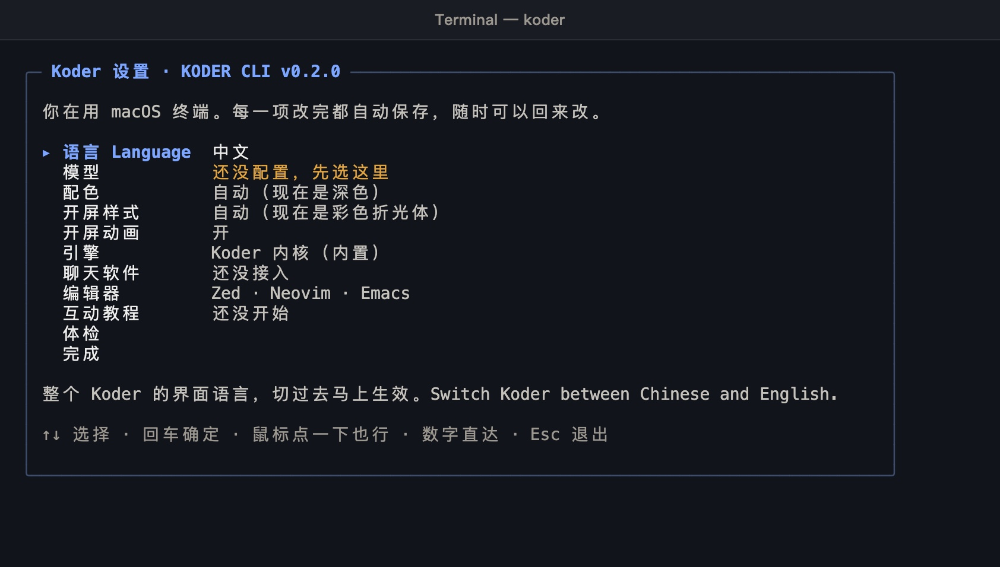
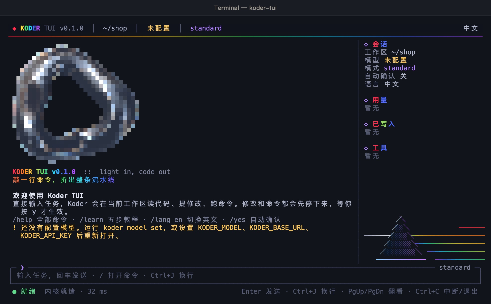
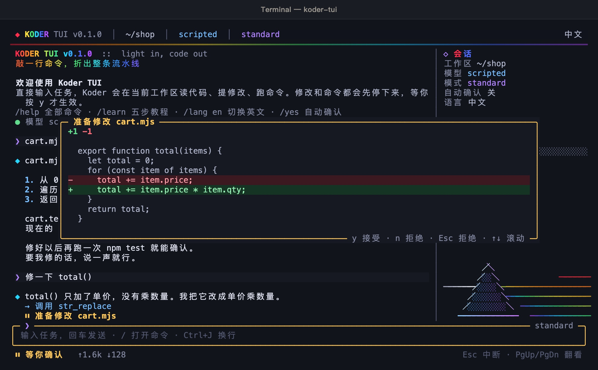

# Koder

Koder 在你自己的电脑上办事。你给出一件事，它在当前项目里读代码、提出修改、运行命令。每一次改文件、每一次运行命令，都先停下来等你确认。模型由你自己接入，并和那家服务商结算。这一版不含模型。

官网：<https://karmenloop.com>  
产品页：<https://karmenloop.com/cli.html>  
更新：<https://karmenloop.com/updates.html>  
下载：<https://karmenloop.com/download.html>  
邮箱：<info@karmenloop.com>

## 产品

| 产品 | 在哪里用 | 怎么打开 |
| --- | --- | --- |
| Koder 电脑版 | 窗口里看任务、差异和确认 | 官网下载页 |
| Koder TUI | 终端占满一屏 | `koder-tui` |
| Koder CLI | 终端里一句话完成审查、修改、测试和流程 | `koder` |

三处共用同一套模型配置和语言。本仓库是 CLI 的源码，许可证是 MIT。电脑版和 TUI 的安装包在官网。TUI 和 CLI 读同一份 `koder setup` 的结果。

## 内核

内核叫 KARMEN LOOP。它不公开，不在本仓库里，也不在安装包的源码里，不适用 MIT 许可证。版权所有 © KARMEN / Koder，保留所有权利。官网安装包运行时使用这份内核；下载安装包不是取得内核源码，也不提供内核的二次开发。

## CLI 能做的事

- 对话：直接输入 `koder`，在项目目录里交代任务。
- 一次性任务：`koder run` 改文件、跑命令；`koder ask` 只读，不改文件、不跑命令。
- 质量：`koder review` 审查改动，`koder fix` 按检查结果反复修，`koder test` 沿用现有测试的写法补测试。
- 编排：`koder flow` 用 JSON 把多步串起来；`koder ci init` 写入 GitHub Actions，在 PR 上审查和评论。
- 接入：飞书、企业微信、微信、钉钉、Telegram、Slack、Discord、WhatsApp。编辑器通过 `koder acp` 和 `koder editor` 接入。
- 设置：`koder setup` 用方向键或鼠标选择语言、模型、配色、开屏、引擎和聊天软件。
- 教程：`koder learn` 是 17 课，按 PowerShell、CMD、macOS、Linux 分别写命令，进度会记住。

## 画面

第一次输入 `koder`，打开设置。模型还没配时，这一项标着还没配置。方向键或鼠标可以选择。



`koder run` 要改文件时，先列出差异。红色是删掉的行，绿色是新加的行。输入 y 才写入，其他键不写入。


`koder help review` 列出这个命令的用法、选项和例子。其他命令同样用 `koder help 命令名` 查看。


`koder-tui` 占满一屏：顶栏是版本、工作区、模型和模式，中间是对话，底下是输入框。



TUI 里要改文件时弹出差异窗口。y 接受，n 或 Esc 拒绝。



上面两张修改画面拍的时候，回复来自本机按脚本准备的测试接口，不是一家已接入的模型服务。界面本身是 Koder CLI 0.2.0 和 Koder TUI 0.1.0 的真实画面。

## 安装

按系统复制一行，粘贴进终端，回车。不需要邀请码，也不需要管理员。装完输入 `koder`。

脚本原文：

- <https://karmenloop.com/install/koder-cli.sh>
- <https://karmenloop.com/install/koder-cli.ps1>
- <https://karmenloop.com/install/koder-cli.cmd>

macOS 11 及以上、Linux、WSL：

```bash
curl -fsSL https://karmenloop.com/install/koder-cli.sh | bash
```

Windows 10 / 11 的 PowerShell：

```powershell
irm https://karmenloop.com/install/koder-cli.ps1 | iex
```

Windows 10 / 11 的命令提示符：

```bat
powershell -NoProfile -ExecutionPolicy Bypass -Command "irm https://karmenloop.com/install/koder-cli.ps1 | iex"
```

Mac 和 Linux 装在 `~/.koder-cli`，启动命令在 `~/.local/bin`。Windows 装在 `%LOCALAPPDATA%\koder-cli`。电脑上已有 Node.js 22 或更高就直接用；没有的话，安装程序从 nodejs.org 下载 Node.js 22，先核对 SHA-256 再解压。Koder 的安装包同样先核对 SHA-256，不一致就停下。

Windows XP、7、8 不能安装。Node.js 22 需要 Windows 10。

装好后的终端画面：


已经装好时，查看版本和官网，或更新：

```bash
koder version
koder about
koder update
```

TUI 另装。装好后输入 `koder-tui`。

```bash
curl -fsSL https://karmenloop.com/install/koder-tui.sh | bash
```

```powershell
irm https://karmenloop.com/install/koder-tui.ps1 | iex
```

脚本原文：<https://karmenloop.com/install/koder-tui.sh> · <https://karmenloop.com/install/koder-tui.ps1> · <https://karmenloop.com/install/koder-tui.cmd>

## 使用教程

### 1. 打开设置，接上模型

安装结束会进入设置。方向键或鼠标选择语言、模型和配色，改完即保存。

```bash
koder setup
koder lang en
```

以 DeepSeek 为例。先把密钥放进环境变量，再让 Koder 读取这个变量。配置文件里只记变量名。

macOS、Linux：

```bash
export DEEPSEEK_API_KEY="你的密钥"
koder model set --preset deepseek --key-env DEEPSEEK_API_KEY
```

Windows PowerShell：

```powershell
$env:DEEPSEEK_API_KEY = "你的密钥"
koder model set --preset deepseek --key-env DEEPSEEK_API_KEY
```

本机 Ollama：

```bash
koder model set --preset local --model qwen3:8b
```

`koder model presets` 列出全部预设。配置在 `~/.koder-cli/provider.json`，权限 600。用 `--key-env` 时文件里是变量名；直接粘贴的密钥按明文保存。配好后运行：

```bash
koder doctor
```

### 2. 进入项目，开始对话

```bash
cd 你的项目文件夹
koder
```

直接输入要做的事，回车。Koder 只在这个文件夹里读写文件。

对话里：`/help` 看命令，`/setup` 打开设置，`/about` 看官网和更新页，`/lang en` 切英文，`/exit` 或 Ctrl+D 退出。

### 3. 确认修改

不进对话，也可以一句话交代：

```bash
koder run "npm test 没过，修一下 cart.mjs 里的 total()"
```

改文件和运行命令都会先问你。输入 y 接受，其他键拒绝。拒绝的修改不会写进文件。

脚本里加上 `--yes` 才自动接受修改和命令。不加时，修改和命令一律拒绝。`--yes` 不代替你回答选择题，也不填写密码。

```bash
koder run --yes --json "补上 README 的安装说明"
```

`--json` 每行一个事件。退出码 0 是完成，1 是中断或任务出错，2 是没能运行，例如模型没配好或参数不对。

### 4. 审查、修复、补测试

```bash
koder ask "登录流程从哪个文件开始？"
npm test 2>&1 | koder run "根据这段失败输出修好测试"
koder review --base origin/main --format markdown --out review.md
koder fix --check "npm test"
koder test src/price.js --check "npm test"
```

`review` 读取改动、仓库结构、`AGENTS.md` 这类规则和最近的提交，写出每条问题的文件、行号、级别和修改建议。`fix` 运行检查，失败就把输出交给 Koder 修，修完再查，直到通过或用完次数，默认 3 次。

### 5. 教程、流程和 CI

```bash
koder learn
koder learn 3
koder learn --print --os powershell
koder flow init pr-gate
koder ci init
```

`koder learn` 在终端里上课，进度会记住。`--print` 只印文字。`--os` 用 `powershell`、`cmd`、`mac` 或 `linux`。第 16 课是安装和更新。

`koder ci init` 写入 `.github/workflows/koder.yml`。PR 打开或更新时审查并评论。PR 里评论 `/koder review`、`/koder fix` 会触发对应动作。会改仓库的指令只接受仓库成员。

### 6. 聊天软件和编辑器

```bash
koder gateway setup feishu
koder gateway start --background
koder editor zed
koder acp
```

`koder editor` 的参数可以是 `zed`、`nvim`、`emacs`。它印出对应编辑器的配置。

### 7. TUI

```bash
cd 你的项目文件夹
koder-tui
```

直接输入任务，Enter 发送，Ctrl+J 换行。输入 `/` 打开命令，其中有 `/help`、`/learn`、`/lang`、`/mode`、`/yes`、`/model`、`/sidebar`、`/about`、`/exit`。Esc 中断当前这一轮，已经接受的修改会保留。

TUI 读取 `koder setup` 写好的模型。还没配时，先完成上面的第 1 步。

## 常用选项

| 选项 | 作用 |
| --- | --- |
| `-w`、`--workspace` | 工作区，默认当前目录 |
| `-y`、`--yes` | 自动接受文件修改和命令 |
| `--json` | 每行一个 JSON 事件 |
| `--mode` | standard、code、minimal、plan、execute、report、enhance |
| `--lang` | 这一次用中文或英文 |
| `--no-color` | 关闭颜色 |

每个命令的完整说明：`koder help`，或 `koder help 命令名`。

## 许可证

本仓库的 Koder CLI 源码采用 MIT 许可证，全文见 `LICENSE`。第三方组件见 `THIRD_PARTY_NOTICES.md`。

KARMEN LOOP 内核不在本仓库，不公开，不适用 MIT 许可证。版权所有 © KARMEN / Koder。保留所有权利。不提供内核的二次开发。

官网 <https://karmenloop.com> · 邮箱 <info@karmenloop.com>
