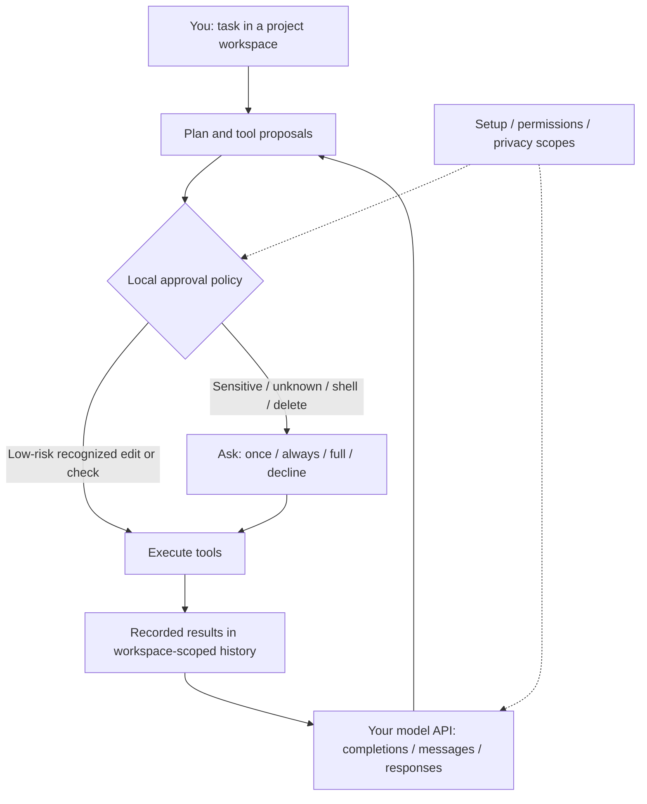
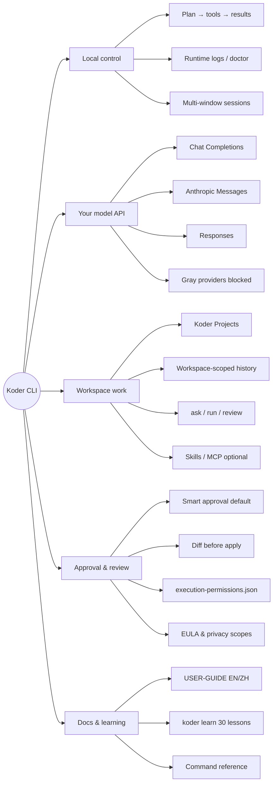
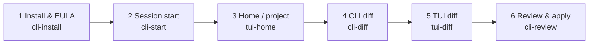

> 0.4.10 extends foreground command time limits and preserves a visible checkpoint at the tool-step cap. [Changes and verification limits](docs/RELEASE-0.4.10.md).

# Koder CLI

[English](README.md) · [简体中文](README.zh-CN.md) · **v0.4.10**

[](https://github.com/KarmenLoop/koder-cli/releases/tag/cli-0.4.10)
[](https://github.com/KarmenLoop/koder-cli/actions/workflows/windows-installer.yml)
[](https://nodejs.org/)
[](EULA.md)
[](docs/INSTALLATION.md)

**A terminal coding agent that plans, proposes, and applies work on your machine—with your own model API, workspace-isolated history, and local approval before sensitive changes.**

Koder CLI is a **local task tool** from the [KARMEN LOOP](https://karmenloop.com) team. Bring your own provider key or supported local model, choose a project, and work through plans, tools, approvals, and recorded results. **Personal, noncommercial local use is free and does not require membership or an invite code.** Commercial use and organizational deployment need separate written authorization. Providers may charge for API requests.

Current release: **[0.4.10](https://github.com/KarmenLoop/koder-cli/releases/tag/cli-0.4.10)** · Agreement: **[Koder-EULA-1.1](EULA.md)** · Site: [karmenloop.com/cli.html](https://karmenloop.com/cli.html)

> Upgrading from 0.4.4 or earlier: if an older updater rejects the larger package, run the current official installer once. Configuration and history are retained. [Migration notes](docs/RELEASE-0.4.10.md).


*Session start — official product capture.*

[Download 0.4.10](https://github.com/KarmenLoop/koder-cli/releases/tag/cli-0.4.10) · [Installation](docs/INSTALLATION.md) · [English guide](docs/USER-GUIDE.en.md) · [Chinese guide](docs/USER-GUIDE.zh.md) · [Release notes](docs/RELEASE-0.4.10.md) · [Command reference](docs/COMMAND-REFERENCE.en.md)

---

## Why this exists

Most terminal agents either hide what they will change, or treat every model suggestion as permission. Teams that already pay for model APIs should not need a second membership gate just to run a local client—and they should see **what will run** before sensitive edits, deletes, or shell effects land.

Koder keeps four things deliberate:

1. **Your model, your bill** — Chat Completions, Anthropic Messages, and Responses; catalog entries show current availability next to historical references. A website subscription is never assumed to be API access.
2. **Local control plane** — planning, permission checks, tool execution, and saved results stay on your machine under the KARMEN LOOP kernel narrative. Execution grants are hashed and scoped; they are not synchronized as “memory.”
3. **Smart approval by default** — recognized low-risk local checks and ordinary project edits can proceed; code execution, deletion, secret paths, shell effects, unknown commands, and external app actions ask. The decision comes from **local policy code**, not a model’s claim.
4. **Honest boundaries** — gray provider rows stay unselectable; native Windows GUI / ConPTY / real mailbox / model-quality paths that were not run stay labeled **NOT_RUN** in release evidence.

It does **not** claim that local fixtures certify every PC, provider account, or model quality score.

---

## Snapshot

| | |
|---|---|
| **What you install** | Versioned CLI runtime via official Windows / macOS / Linux installers (Node **^22.21.0 or ≥24**, reused or downloaded and checksum-verified) |
| **What you bring** | Your own model API key or a supported local model endpoint |
| **Version** | **0.4.10** (`RELEASE.json`, release tag `cli-0.4.10`, stable channel) |
| **License for this build** | **Koder-EULA-1.1** — proprietary end-user license for the current application runtime |
| **Personal use** | Free for personal, noncommercial local use — **no membership, no invite code** |
| **Commercial / org** | Separate prior written authorization (`koder business` / [commercial licensing](docs/COMMERCIAL-LICENSING.md)) |
| **Projects** | New website / slides / app work uses **Koder Projects** folders unless `-w` or an existing workspace is set |
| **History** | Task history and automatic facts are **workspace-scoped**; `default` means default session *of that workspace* |
| **Learning coach** | `koder learn` — 30 lessons, EN/ZH, PowerShell / CMD / macOS / Linux; disposable project; **no paid model required** |
| **Optional depth** | Portable Skills, Harness profiles, residency, mail inquiry, Windows-MCP / Code Graph presets, celebrations |
| **Public GitHub tree** | Retains historical **GPL 0.3.1** source; that tree **does not** build this proprietary installer ([source status](SOURCE-STATUS.md)) |

---

## Is / Is not

| Is | Is not |
|---|---|
| Local **terminal coding agent** with BYO model API | Hosted coding SaaS or bundled paid model quota |
| Free personal noncommercial local use without membership | Permission for commercial / organizational deployment without written auth |
| Smart approval + diff-oriented review before sensitive apply | Operating-system sandbox or admin elevation |
| Workspace-isolated task history and project folders | One global chat that mixes every repo’s facts |
| Official installers with SHA-256 verification and EULA `accept` step | Silent license accept via empty Enter (empty input asks again) |
| Grayed, blocked routes for known broken provider integrations | Silent billing-route switch or automatic “backup engine” fallback |
| Documented NOT_RUN limits for native Windows / real accounts | Claim that macOS fixtures certify Windows GUI or model quality |
| Supported config / skills / MCP extension points | Right to modify or redistribute proprietary runtime source |
| Fail-closed execution records (`execution-permissions.json`) | Permission restored from a damaged or partial grant file |
| Opt-in residency, mail, remote resources, celebrations | Capabilities enabled merely by accepting the EULA |

---

## Architecture

Three layers stay separate on purpose. The model proposes; the local policy decides; the workspace records.

1. **Client & session** — interactive chat, editable `/` prompt choices, mid-run steer-or-queue, multi-window task sessions, and bounded private runtime logs (`koder logs`, doctor). Queued text cannot approve a pending sensitive prompt.
2. **Control plane** — plan → local permission policy → tool execution → recorded results. Grants are action-hashed and scoped to a workspace (or an explicit profile with confirm). They live under the local CLI home as `execution-permissions.json` and are **not** synced as conversation memory.
3. **Your model & tools** — Chat Completions, Anthropic Messages, or Responses on endpoints you configure. Optional MCP / Skills / apps attach only after their own setup and approvals. Protocol compatibility does not certify every third-party service.



**Isolation note.** The session label `default` means the default session **of that canonical workspace**, not one global conversation across every folder. Private transcripts live in the user Koder profile, indexed by workspace and session—not inside a public site output directory.

---

## Product mind map

How the pieces fit together at a glance—control stays local; the model is yours; sensitive apply waits for approval.



---

## Screenshot roadmap

Six real captures from `docs/screenshots/`, ordered as a first-success path. The [Guided walkthrough](#guided-walkthrough) embeds each image under its step—hero stays lean on purpose.



| Step | What you do | Screenshot |
|---|---|---|
| 1 | Run the installer and type `accept` at the EULA prompt | [`cli-install-en-dark.jpg`](docs/screenshots/cli-install-en-dark.jpg) |
| 2 | Reopen the terminal, verify version, enter a session | [`cli-start-en-dark.jpg`](docs/screenshots/cli-start-en-dark.jpg) |
| 3 | Finish `koder setup`, open a project / TUI home | [`tui-home-en-dark.jpg`](docs/screenshots/tui-home-en-dark.jpg) |
| 4 | Give a first task; inspect the proposed CLI diff | [`cli-diff-en-dark.jpg`](docs/screenshots/cli-diff-en-dark.jpg) |
| 5 | Optionally review the same change in the TUI diff view | [`tui-diff-en-dark.jpg`](docs/screenshots/tui-diff-en-dark.jpg) |
| 6 | Approve or decline; run `koder review` when you want a structured pass | [`cli-review-en-dark.jpg`](docs/screenshots/cli-review-en-dark.jpg) |

---

## Capabilities at a glance

| Area | What you get | Where it stops |
|---|---|---|
| **Chat & Agent** | Interactive `koder`, `ask`, `run`, modes, `/` editable choices, mid-run steer or queue | Modes are not permission grants; queued text cannot approve a pending prompt |
| **Projects** | `koder project create|list|status`, `/project`, Koder Projects home | Does not scatter project files into the program install directory |
| **Delivery checks** | Current-turn artifact / format / receipt checks with bounded repair | Not a coding or writing quality score ([TASK-DELIVERY](docs/TASK-DELIVERY.en.md)) |
| **Visual workflow** | Three HTML directions before full build; companion `/preview`; H5 atlas at handoff | Browser prototype ≠ native device acceptance ([VISUAL-WORKFLOW](docs/VISUAL-WORKFLOW-AND-NETLIFY.md)) |
| **Skills & MCP** | Portable skills, catalog/read on demand, compatibility inventory | Protocol compatibility ≠ every third-party service certified ([inventory](docs/MCP-SKILL-INVENTORY.md)) |
| **Growth method** | Bundled `personal-agent-growth` method via `koder growth status|show|on|off` | No profiling sync, background service, or new API budget by default ([guide](docs/AUTONOMOUS-LEARNING.md)) |
| **Residency & mail** | Opt-in `koder activate` / `status` / `deactivate`; mail inquire → draft → confirm send | Off by default; ads/OTP excluded ([ALWAYS-ON](docs/ALWAYS-ON.en.md)) |
| **Windows depth** | Optional Windows-MCP + Code Graph presets; bundled x64 runtime on Windows packages | GUI / cold-install paths may remain NOT_RUN ([MCP-INTEGRATIONS](docs/MCP-INTEGRATIONS.en.md)) |
| **Celebrations** | Optional `koder celebrate` effects; reduced-motion respected | License accept does not enable birthday, music, or geo lookup |

---

## Install

Use **Windows 10/11**, **macOS**, **Linux**, or **WSL** with the matching shell. Normal installation does **not** require administrator access. Read the [EULA](EULA.md), [acceptance guide](ACCEPTANCE.md), [legal notice](LEGAL-NOTICE.md), and [CLI privacy](docs/privacy/consumer-privacy.en.md) before typing `accept`.

Choose **one** command. Wait for `accept / decline:`, type `accept`, press Enter. `decline` or Ctrl+C cancels. Empty Windows input asks again — it does **not** accept. License acceptance enables **no** optional computer, mail, learning, sync, birthday, music, or country-lookup permissions.

The matching screenshot lives in [walkthrough step 1](#1-install-and-accept-the-eula).

### Windows PowerShell

```powershell
$ErrorActionPreference='Stop'; $ProgressPreference='SilentlyContinue'; [Net.ServicePointManager]::SecurityProtocol=[Net.ServicePointManager]::SecurityProtocol -bor [Net.SecurityProtocolType]::Tls12; $u='https://karmenloop.com/install/koder-cli.ps1'; Write-Host ('Koder: loading installer from '+([Uri]$u).Host+'...'); $limit=100000000; if($env:KODER_DOWNLOAD_TIMEOUT_SECONDS){$v=0; if([int]::TryParse($env:KODER_DOWNLOAD_TIMEOUT_SECONDS,[ref]$v) -and $v -ge 1 -and $v -le 100000000){$limit=$v}else{throw 'KODER_DOWNLOAD_TIMEOUT_SECONDS must be 1..100000000'}}; $connect=30; if($env:KODER_DOWNLOAD_CONNECT_TIMEOUT_SECONDS){$v=0; if([int]::TryParse($env:KODER_DOWNLOAD_CONNECT_TIMEOUT_SECONDS,[ref]$v) -and $v -ge 1 -and $v -le 3600){$connect=$v}else{throw 'KODER_DOWNLOAD_CONNECT_TIMEOUT_SECONDS must be 1..3600'}}; $bootstrapLimit=[Math]::Min($limit,$connect); $client=New-Object Net.WebClient; $client.Encoding=[Text.Encoding]::UTF8; $clock=[Diagnostics.Stopwatch]::StartNew(); $next=5; try{$task=$client.DownloadStringTaskAsync([Uri]$u); $wait=([IAsyncResult]$task).AsyncWaitHandle; while(-not $wait.WaitOne(200)){if($clock.Elapsed.TotalSeconds -ge $bootstrapLimit){if($limit -le $connect){throw ('Installer download timed out after '+$limit+'s')}; throw ('Installer bootstrap stalled after '+$connect+'s')}; if($clock.Elapsed.TotalSeconds -ge $next){Write-Host ('Still loading installer: '+[int]$clock.Elapsed.TotalSeconds+'s elapsed. Ctrl+C cancels.'); $next+=5}}; $script=$task.GetAwaiter().GetResult()}finally{$client.CancelAsync(); $client.Dispose()}; Invoke-Expression $script
```

### Windows Command Prompt (CMD)

Paste the complete line at a **CMD** prompt (not into PowerShell):

```bat
powershell -NoProfile -ExecutionPolicy Bypass -Command "$ErrorActionPreference='Stop'; $ProgressPreference='SilentlyContinue'; [Net.ServicePointManager]::SecurityProtocol=[Net.ServicePointManager]::SecurityProtocol -bor [Net.SecurityProtocolType]::Tls12; $u='https://karmenloop.com/install/koder-cli.ps1'; Write-Host ('Koder: loading installer from '+([Uri]$u).Host+'...'); $limit=100000000; if($env:KODER_DOWNLOAD_TIMEOUT_SECONDS){$v=0; if([int]::TryParse($env:KODER_DOWNLOAD_TIMEOUT_SECONDS,[ref]$v) -and $v -ge 1 -and $v -le 100000000){$limit=$v}else{throw 'KODER_DOWNLOAD_TIMEOUT_SECONDS must be 1..100000000'}}; $connect=30; if($env:KODER_DOWNLOAD_CONNECT_TIMEOUT_SECONDS){$v=0; if([int]::TryParse($env:KODER_DOWNLOAD_CONNECT_TIMEOUT_SECONDS,[ref]$v) -and $v -ge 1 -and $v -le 3600){$connect=$v}else{throw 'KODER_DOWNLOAD_CONNECT_TIMEOUT_SECONDS must be 1..3600'}}; $bootstrapLimit=[Math]::Min($limit,$connect); $client=New-Object Net.WebClient; $client.Encoding=[Text.Encoding]::UTF8; $clock=[Diagnostics.Stopwatch]::StartNew(); $next=5; try{$task=$client.DownloadStringTaskAsync([Uri]$u); $wait=([IAsyncResult]$task).AsyncWaitHandle; while(-not $wait.WaitOne(200)){if($clock.Elapsed.TotalSeconds -ge $bootstrapLimit){if($limit -le $connect){throw ('Installer download timed out after '+$limit+'s')}; throw ('Installer bootstrap stalled after '+$connect+'s')}; if($clock.Elapsed.TotalSeconds -ge $next){Write-Host ('Still loading installer: '+[int]$clock.Elapsed.TotalSeconds+'s elapsed. Ctrl+C cancels.'); $next+=5}}; $script=$task.GetAwaiter().GetResult()}finally{$client.CancelAsync(); $client.Dispose()}; Invoke-Expression $script"
```

### macOS / Linux / WSL

```sh
curl -fsSL https://raw.githubusercontent.com/KarmenLoop/koder-cli/main/install/koder-cli.sh | bash
```

Downloads show progress and verify SHA-256. Reopen the terminal after success, then:

```text
koder --version
koder setup
```

`koder --version` should report **0.4.10**. Full platform notes: [Installation](docs/INSTALLATION.md).

---

## Start working

After install and a fresh terminal:

```text
koder setup
koder learn
koder
```

- `koder setup` — connect your model API (required before real tasks).
- `koder learn` — optional 30-lesson coach on a disposable project; **no paid model**.
- `koder` — interactive chat in the current workspace.

Prefer a scripted first success? Follow the [Guided walkthrough](#guided-walkthrough) below.

---

## Guided walkthrough

A first-success path from zero to a conscious approve-or-decline. Deeper workflows (projects, preview, Netlify, mail, residency) live in the [English user guide](docs/USER-GUIDE.en.md) and [Chinese user guide](docs/USER-GUIDE.zh.md)—this section alone is enough to install, configure, run one task, read the diff, and decide.

### 1. Install and accept the EULA

1. Pick **one** installer command from [Install](#install) above (PowerShell, CMD, or macOS/Linux/WSL).
2. Wait until progress finishes and the prompt shows exactly: `accept / decline:`.
3. Type `accept` and press Enter. Type `decline` or press Ctrl+C to cancel. On Windows, an empty Enter **asks again**—it does not accept.
4. When the installer finishes, **close and reopen** the terminal so `PATH` refreshes.


*Step 1 — installer progress and the EULA prompt. Acceptance enables no optional computer, mail, sync, or celebration extras.*

### 2. Confirm the binary and open a session

```text
koder --version
koder
```

Expect **0.4.10**. Bare `koder` opens interactive chat. Prefer a short coach first?

```text
koder learn
```

`Enter` continues a lesson, `b` goes back, `q` leaves. Offline text editions: `koder learn --print --os mac --lang en` (also `powershell` / `cmd` / `linux`; `--lang zh` for Chinese).


*Step 2 — session start after a clean install.*

### 3. Configure your model API and pick a project

```text
koder setup
```

In setup:

1. Choose an **available** (non-gray) provider entry.
2. Enter the exact model ID, protocol, and endpoint your account issues.
3. Prefer an environment-variable key reference when you do not want the key value stored in the profile; never paste a key into a task, screenshot, or issue.
4. A website subscription is **not** automatically API access.

Then create or select a project. New website / slides / app work defaults to **Koder Projects** under your home directory unless you pass `-w` or continue an existing workspace:

```text
koder project create "Studio Site" --kind website
koder project create "Quarterly Review" --kind slides
koder project create "Studio App" --kind app
koder project list --json
koder project status
koder chat -w /absolute/path/to/existing-project
```

Inside chat: `/project create "Another Site" --kind website` creates and selects; `/project open "/absolute/path"` returns to an existing folder. Name collisions are rejected—files are not merged.


*Step 3 — TUI home after setup; confirm the workspace before the first real task.*

Smoke-test the provider when ready (these calls may incur provider charges):

```text
koder model presets
koder model test
koder model test --tools
```

`model test` uses a short diagnostic budget; a text reply proves text access only. `--tools` requests a harmless tool round-trip and continuation.

### 4. Run a first task and read the CLI diff

In chat, type a concrete, bounded ask—for example: explain a file, add a short README note, or repair a failing local check. Or from the shell:

```text
koder ask "Explain the architecture of this project" --lang en
koder run "Add a short note to README about local setup" --lang en
```

| Command | Behavior |
|---|---|
| `ask` | Answers **without** proposing file edits |
| `run` | May propose tools under the approval policy |
| `--mode plan\|code\|execute\|…` | Work **modes**, not permission grants |
| `--session name` | Named session **inside this workspace** |
| `--new` / `--no-memory` | Fresh topic / no saved task history for this call |

When the agent proposes project edits, **read the CLI diff before you approve**:

1. Paths — are they inside the intended project?
2. Deletions — intentional, or collateral?
3. Secrets / config — anything near keys, `.env`, credentials, or deploy config?
4. Scope — does the hunk match the ask, or drift into unrelated files?


*Step 4 — CLI diff-oriented review. Approval policy, not an OS sandbox.*

### 5. Optional: review the same change in the TUI

If you prefer a full-screen view, open the TUI diff for the pending change. Captions and hunks match the CLI story—same workspace, same policy. Approve or decline with equal care.


*Step 5 — TUI diff of a proposed change.*

### 6. Approve or decline — then optionally run review

At a sensitive prompt:

| Input | Effect |
|---|---|
| **y** | Allow **this** action once |
| **a** / `always` | Save that **exact** action for this workspace |
| **f** / `full` | Full access for this workspace (or `--scope profile` with explicit confirm) |
| Enter / **n** | Decline |

Decline is a first-class outcome. An unknown result is not success—verify state before retrying a send, payment, or deployment.

After you accept, the change lands in workspace-scoped history. For a structured review pass:

```text
koder review
koder review --format json
```

Use `koder review` when you want findings after apply, before a larger follow-up, or when a CI-style gate should distinguish a clean parse from failure. If a successful model answer still cannot be parsed into complete findings, the CLI exits **3** with `REVIEW_UNPARSED`—do **not** treat that as a clean review.


*Step 6 — review / fix loop after apply.*

**First success** means: version reports 0.4.10, setup has a working (non-gray) provider, one task produced a readable diff, and you consciously approved or declined. For multi-window sessions, Skills/MCP, residency, and mail inquiry, continue in the [user guide](docs/USER-GUIDE.en.md).

Day-to-day chat: type `/` on an empty prompt for editable choices (Tab fills, Esc closes, Enter sends only after fill). `/setup` opens settings, `/model` manages models, `/new` starts a topic, `/exit` leaves. `/menu` opens settings; Escape leaves.

---

## Safety: approvals, diffs, and permissions

Smart approval is the default: recognized low-risk local checks and ordinary project edits can proceed without a question. Code execution, deletion, secret or configuration paths, shell effects, unknown commands, and external application actions **ask**. The decision is computed by local policy code—not by trusting the model’s description of risk.

This is an **approval policy**, not an OS sandbox. It does not elevate privileges, bypass accessibility prompts, or replace your provider’s security model.

At a sensitive prompt: **y** once, **a** / always for that exact action in this workspace, **f** / full for this workspace (or `--scope profile` with explicit confirm), Enter / **n** to decline.

```sh
koder permissions execution status
koder permissions execution ask
koder permissions execution auto
koder permissions execution full --confirm FULL
koder permissions execution full --scope profile --confirm FULL
koder permissions execution revoke all
koder permissions execution reset
```

| Control | Scope |
|---|---|
| `ask` / `auto` / `full` | Persistent execution policy for the workspace (or profile with confirm) |
| `revoke all` | Return this workspace to smart mode; remove applicable saved rules |
| `reset` | Remove all saved execution settings |
| `--approval auto\|ask\|full\|deny` | **Current run only** |
| `--yes` | Temporary convenience; **cannot** override explicit deny, accept the EULA, supply passwords, or grant OS accessibility |

Rules live under the local CLI home as `execution-permissions.json` (host/workspace scope + action hashes—not raw commands or keys). Damaged records **fail closed**: Koder offers a fresh decision; they do not silently restore broad access. Execution authority is not synchronized as memory.

Privacy and feedback stay offline-readable:

```text
koder privacy consumer
koder privacy statement
koder privacy desktop
koder privacy agreement
koder privacy sources
koder feedback
koder permissions status
```

`koder feedback` opens a blank template for **info@karmenloop.com** — nothing is sent or attached automatically. Strip keys, passwords, private paths, and personal records before you send.

---

## Models and providers

Configure in `koder setup` or with explicit profile commands. Keep three boundaries clear:

1. **Billing** — Koder does not replace your provider’s billing. Website membership ≠ API access.
2. **Protocols** — Chat Completions, Anthropic Messages, and Responses. Catalog rows may show historical references; **current availability** is shown next to each entry.
3. **No silent fallback** — independent plan entries keep independent hosts, keys, and billing routes. The internal backup engine stays disabled and gray by default.

```text
koder model presets
koder model models aliyun-coding-plan
koder model test
koder model test --tools
koder model set --model ACTUAL_MODEL_ID --base-url OFFICIAL_API_BASE --protocol openai --key-env MY_PROVIDER_KEY
```

See [PROVIDERS.md](docs/PROVIDERS.md) and [MIMO.md](docs/MIMO.md) for endpoints and safe setup.

**Temporarily unavailable (gray, blocked before network):** MiMo Token Plan, Kimi API, Kimi Code, DeepSeek, Alibaba Token Plan, Volcano Coding Plan, and Volcano Ark API. Existing profiles remain for view/remove; activation, test, refresh, and execution stay blocked. No automatic billing-route switch.

---

## What 0.4.10 emphasizes

From the [0.4.10 release notes](docs/RELEASE-0.4.10.md)—product outcomes, not a changelog dump:

- Live steering waits for session preparation; busy chat keeps usable `/` choices and editable drafts
- Interruptions distinguish exact stop language from ordinary task text; queue order is preserved
- Bounded private runtime diagnostics (`koder logs`, doctor) without dumping task bodies or credentials
- Blocked or empty outcomes return actionable nonzero results instead of silent success

Retained multi-window, Skills/MCP, Headroom context optimization, residency, and mail flows remain documented separately — enable only what you authorize.

---

## Private collections and company licensing

Remote references stay **off** by default. Opt in per command with `koder resources search "keywords" --remote`, or set `KODER_REMOTE_RESOURCES=1` for agent-visible remote tools (`0` forces off). Import local archives with `koder resources import` — originals stay local; see [REMOTE-RESOURCES](docs/REMOTE-RESOURCES.md) and [PRIVATE-RESOURCES](docs/PRIVATE-RESOURCES.md).

For company licensing and dedicated private repository delivery: `koder business` or [info@karmenloop.com](mailto:info@karmenloop.com). A separate written agreement defines scope; stars and inquiry emails alone are not authorization ([COMMERCIAL-LICENSING](docs/COMMERCIAL-LICENSING.md)).

---

## Updates

Installed interactive chats may check the official update feed in the background (at most every six hours) and install only when tasks, queues, and drafts are clear. A changed license requires manual review.

```text
koder update --check
koder update
koder update auto status
koder update auto off
koder update auto on
```

`KODER_AUTO_UPDATE=0` disables automatic checks for that process. Scripts and one-shot commands do not auto-install. Details: [AUTO-UPDATE](docs/AUTO-UPDATE.en.md).

---

## Docs map

| Need | Start here | Why it exists |
|---|---|---|
| Install & first model | [INSTALLATION.md](docs/INSTALLATION.md) | Platform shells, Node reuse/download, EULA accept, recovery |
| Complete workflows (EN / ZH) | [USER-GUIDE.en.md](docs/USER-GUIDE.en.md) · [USER-GUIDE.zh.md](docs/USER-GUIDE.zh.md) | End-to-end product narrative beyond first success |
| Every documented command | [COMMAND-REFERENCE.en.md](docs/COMMAND-REFERENCE.en.md) · [zh](docs/COMMAND-REFERENCE.zh.md) | Generated reference for flags and subcommands |
| Providers & protocols | [PROVIDERS.md](docs/PROVIDERS.md) | Endpoints, gray routes, safe key handling |
| Live input, steer/queue, skills UI | [SESSION-INPUT-AND-SKILLS](docs/SESSION-INPUT-AND-SKILLS.en.md) | Busy-time input and on-demand skill loading |
| Scriptable contracts & exit codes | [CLI-CONTRACTS.md](docs/CLI-CONTRACTS.md) | Stdin, clarification, approvals, nonzero meanings |
| Multi-window sessions | [MULTI-WINDOW.md](docs/MULTI-WINDOW.md) | Independent terminal task sessions |
| Residency / mail inquiry | [ALWAYS-ON](docs/ALWAYS-ON.en.md) · [MAIL-PROACTIVE-INQUIRY](docs/MAIL-PROACTIVE-INQUIRY.en.md) | Opt-in always-on and mail draft → confirm send |
| MCP / Skill inventory | [MCP-SKILL-COMPATIBILITY](docs/MCP-SKILL-COMPATIBILITY.en.md) · [inventory](docs/MCP-SKILL-INVENTORY.md) | Switches, deps, verified limits—not a certification of every SaaS |
| Autonomous learning method (bundled) | [AUTONOMOUS-LEARNING.md](docs/AUTONOMOUS-LEARNING.md) | How `personal-agent-growth` attaches without new budgets |
| Troubleshooting | [TROUBLESHOOTING.md](docs/TROUBLESHOOTING.md) | Stalled install, gray providers, common failures |
| Distribution & legacy GPL tree | [DISTRIBUTION.md](DISTRIBUTION.md) · [SOURCE-STATUS.md](SOURCE-STATUS.md) | Proprietary runtime vs historical public tree |
| Printable 30-lesson texts | [docs/tutorials/](docs/tutorials/) | Offline EN/ZH × PowerShell/CMD/mac/linux editions |
| This release | [RELEASE-0.4.10.md](docs/RELEASE-0.4.10.md) | What changed and what remains NOT_RUN |

---

## Validation honesty

Release evidence distinguishes **source / fixture checks**, **installed protocol fixtures**, **hosted native Windows**, **real provider accounts**, and **user devices**. Local no-key regressions exercise CLI behavior with scripted providers; they do **not** certify PowerShell 5.1 cold install, ConPTY/IME, Windows-MCP GUI operation, mailbox delivery, or model quality. Those items remain **NOT_RUN** where the [0.4.10 notes](docs/RELEASE-0.4.10.md) and [Windows install checks](docs/WINDOWS-INSTALL-CHECKS.md) say so.

Ready-to-use packages, installers, and checksums ship as **release assets**. New tags may add distribution documentation without publishing proprietary runtime source to this public tree.

---

## FAQ

**Do I need an invite code or paid membership to install?**  
No. Personal, noncommercial local use is free under Koder-EULA-1.1 and does not require membership. Commercial and organizational use need separate written authorization.

**Whose model API does Koder use?**  
Yours. Configure a provider in setup. Koder does not replace your provider’s billing. Some catalog rows are temporarily gray and blocked (see [Models and providers](#models-and-providers)).

**Will it change my files without asking?**  
Recognized low-risk local checks and ordinary project edits may run under smart approval. Sensitive or unknown effects—including deletion, secret paths, and shell side effects—ask first. Review diffs and targets before approving.

**Is the public GitHub source the 0.4.10 runtime?**  
No. The public tree keeps historical GPL **0.3.1** material for continuity. The **0.4.10** application runtime is proprietary and distributed via the official installer and release feed ([SOURCE-STATUS.md](SOURCE-STATUS.md)).

**Can my company deploy it?**  
Contact [info@karmenloop.com](mailto:info@karmenloop.com) or run `koder business`. Stars, downloads, and inquiry emails alone are not commercial authorization.

**Where do projects and private history live?**  
New creation tasks default to **Koder Projects** under your home directory unless you pass `-w` or continue an existing workspace. Private conversation records stay in the user Koder profile, indexed by workspace and session—not inside a public site output folder.

**When should I run `koder review`?**  
After apply when you want structured findings, before a larger follow-up, or when a gate must distinguish a clean parse from `REVIEW_UNPARSED` (exit 3). It is not a substitute for reading the diff before the first approve.

**Where is the hand-holding tutorial?**  
On this page: [Guided walkthrough](#guided-walkthrough) (with all six screenshots). Full depth: [USER-GUIDE.en.md](docs/USER-GUIDE.en.md) · [USER-GUIDE.zh.md](docs/USER-GUIDE.zh.md) · `koder learn`.

---

## License and contact

- Current distribution: **[EULA.md](EULA.md)** (Koder-EULA-1.1) · scope note: [LICENSE](LICENSE)
- Third-party: [THIRD_PARTY_NOTICES.md](THIRD_PARTY_NOTICES.md) · [OPEN_SOURCE_CREDITS.md](OPEN_SOURCE_CREDITS.md) · [licenses/](licenses/)
- Bundled method packages retain their own licenses (for example the unmodified `personal-agent-growth` method remains AGPL-3.0-only where shipped)

KARMENLOOP Official Team · Shanghai, China · [karmenloop.com](https://karmenloop.com) · [info@karmenloop.com](mailto:info@karmenloop.com)

If Koder is useful, an optional [GitHub star](https://github.com/KarmenLoop/koder-cli) helps others find it. Skip freely — stars never affect installation or licensed features.
