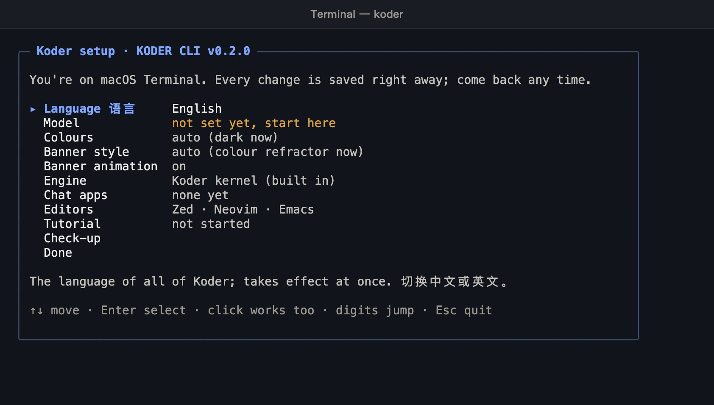
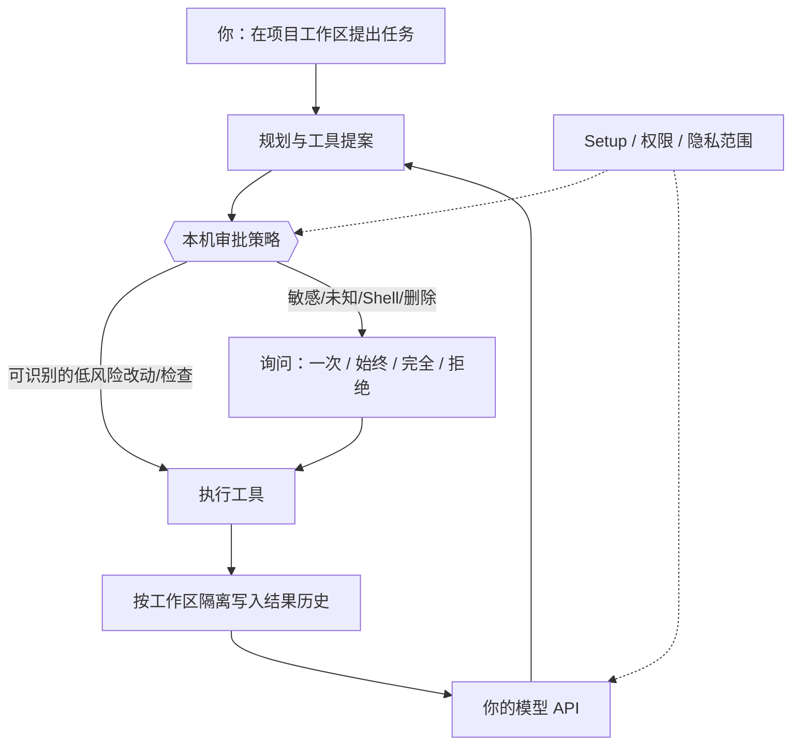
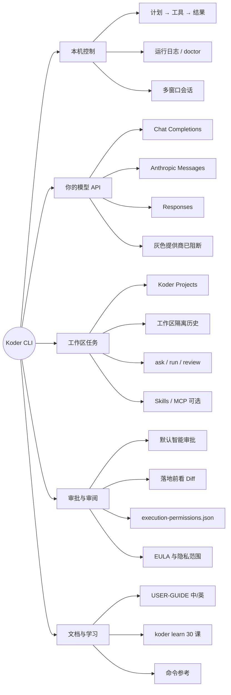
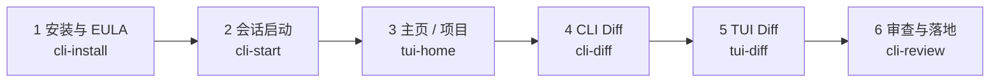
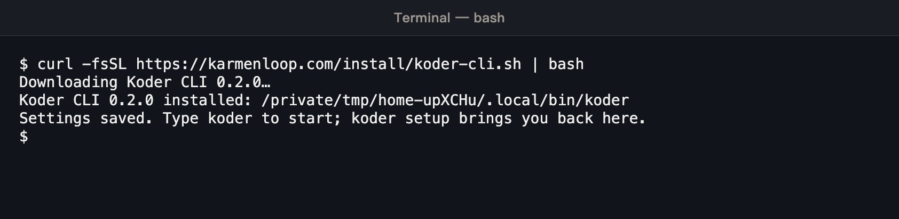
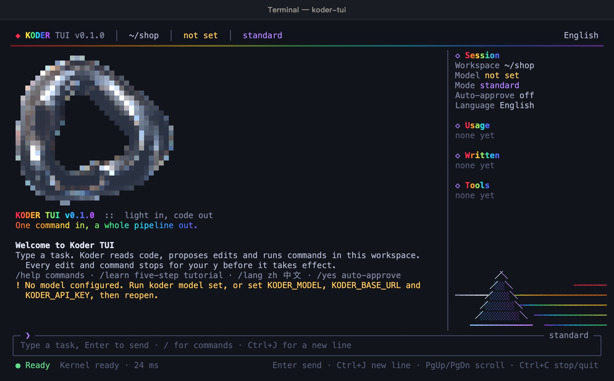
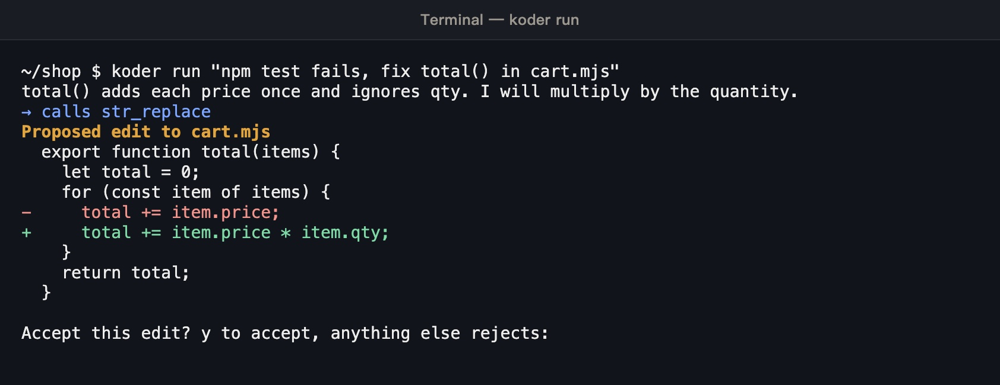
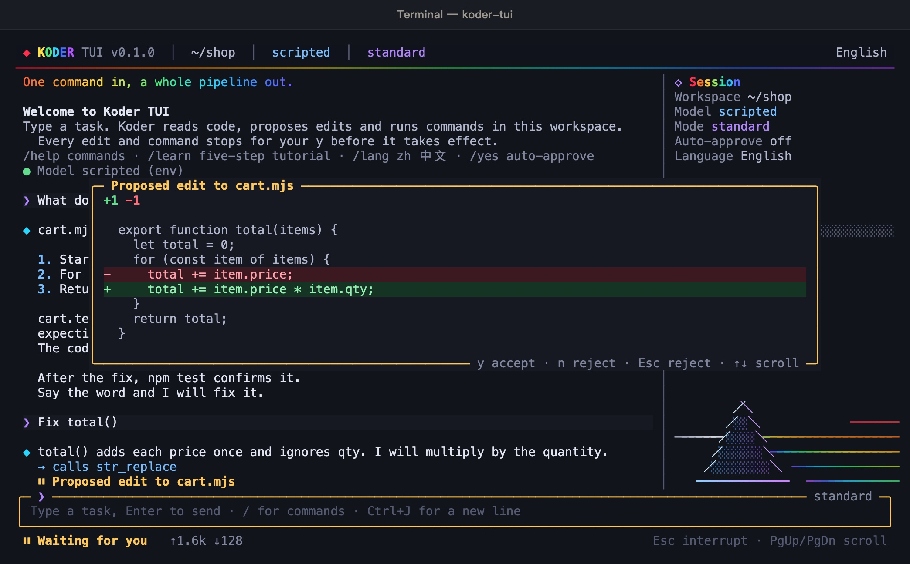
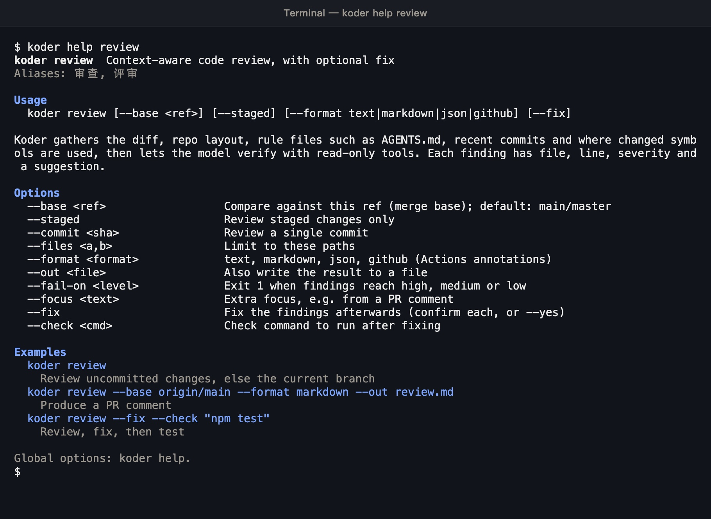

> 0.4.16 补齐本机工具发现、子任务 Todo 交接、检查点查询与 Skill 命令；默认不限轮次，保留取消和共享费用预算。[本版变化](docs/RELEASE-0.4.16.zh.md)。

[从这里开始：安装、更新与全部功能教程](docs/START-HERE.zh.md)

# Koder CLI

[English](README.md) · [简体中文](README.zh-CN.md) · **v0.4.16**

[](https://github.com/KarmenLoop/koder-cli/releases/tag/cli-0.4.16)
[](https://github.com/KarmenLoop/koder-cli/actions/workflows/windows-installer.yml)
[](https://nodejs.org/)
[](EULA.md)
[](docs/INSTALLATION.md)

**本地终端编程 Agent：用你自己的模型 API，在本机完成规划、提案与落地——敏感改动先审批，任务历史按工作区隔离。**

Koder CLI 是 [KARMEN LOOP](https://karmenloop.com) 团队的**本地任务工具**。接入你自己的服务商密钥或受支持的本地模型，选定项目，按计划 → 工具 → 审批 → 结果留存推进工作。**个人非商业本地使用免费，不需要会员，也不需要邀请码。** 商业使用与组织部署须另行取得书面授权。模型/API 费用由服务商另行计收。

当前版本：**[0.4.16](https://github.com/KarmenLoop/koder-cli/releases/tag/cli-0.4.16)** · 协议：**[Koder-EULA-1.1](EULA.md)** · 官网：[karmenloop.com/cli.html](https://karmenloop.com/cli.html)

> 从 0.4.4 或更早升级：若旧更新器因包体积拒绝清单，请用当前官方安装器覆盖升级一次，配置与历史会保留。[安装与升级说明](docs/INSTALLATION.md)。



*会话开始 — 官方产品实机截图。*

[下载 0.4.16](https://github.com/KarmenLoop/koder-cli/releases/tag/cli-0.4.16) · [安装教程](docs/INSTALLATION.md) · [完整中文指南](docs/USER-GUIDE.zh.md) · [English guide](docs/USER-GUIDE.en.md) · [本版更新](docs/RELEASE-0.4.16.zh.md) · [命令参考](docs/COMMAND-REFERENCE.zh.md)

---

## 为什么需要它

许多终端 Agent 要么藏起将要改动的内容，要么把模型建议直接当成许可。已经自费接入模型 API 的人，不该再被第二道会员门槛挡住本地客户端；敏感编辑、删除或 Shell 副作用落地前，也应该能看清**将要执行什么**。

Koder 把四件事钉死：

1. **模型归你，账单归你** — 支持 Chat Completions、Anthropic Messages、Responses；目录在历史条目旁标明当前可用性。网页会员**绝不**被默认等同于 API 权限。
2. **本机控制面** — 在 KARMEN LOOP 内核叙事下，本机完成规划、权限检查、工具执行与结果留存。执行授权按哈希与范围保存，**不会**被同步成「记忆」。
3. **默认智能审批** — 可识别的低风险本地检查与普通工程改动可免问；代码执行、删除、密钥/配置路径、Shell 副作用、未知命令与外部应用动作会询问。判定来自**本地策略代码**，不是模型口头声明。
4. **边界写清楚** — 已知故障的提供商条目保持灰色不可选；未跑过的 Windows 原生 GUI / ConPTY / 真实邮箱 / 模型质量路径在发行证据里标为 **NOT_RUN**。

本机 fixture **不能**证明每台电脑、每个真实账号或模型质量分数都已验收。

---

## 一览

| | |
|---|---|
| **安装什么** | 官方 Windows / macOS / Linux 安装器分发的版本化 CLI 运行时（Node **^22.21.0 或 ≥24**，复用或下载并校验） |
| **你自备什么** | 自己的模型 API Key，或受支持的本地模型端点 |
| **版本** | **0.4.16**（`RELEASE.json`、tag `cli-0.4.16`、stable 通道） |
| **本版许可** | **Koder-EULA-1.1** — 当前应用运行时的专有终端用户许可 |
| **个人使用** | 个人非商业本地使用免费 — **无会员、无邀请码** |
| **商业 / 组织** | 须事先书面授权（`koder business` / [商业授权](docs/COMMERCIAL-LICENSING.md)） |
| **项目** | 新建网站 / 演示稿 / 应用默认进入 **Koder Projects**；`-w` 或已有工程优先 |
| **历史** | 任务历史与自动捕获事实按**工作区隔离**；`default` 表示*该工作区*的默认会话 |
| **互动教程** | `koder learn` — 30 课，中英，PowerShell / CMD / macOS / Linux；临时练习工程；**不调用付费模型** |
| **可选能力** | Portable Skills、Harness、常驻、邮件问询、Windows-MCP / 代码图谱、彩蛋动画等 |
| **公开仓库树** | 保留历史 **GPL 0.3.1** 源码；**不能**用该树构建本专有安装包（[源码状态](SOURCE-STATUS.md)） |

---

## 是 / 不是

| 是 | 不是 |
|---|---|
| 自接模型 API 的本地**终端编程 Agent** | 托管编程 SaaS，或捆绑付费模型额度 |
| 个人非商业本地免费使用（无会员） | 未经书面授权的商业 / 组织部署许可 |
| 智能审批 + Diff 审阅后再敏感落地 | 操作系统沙箱或管理员提权 |
| 按工作区隔离的任务历史与项目目录 | 把所有仓库事实混在一个全局聊天里 |
| 官方安装器 + SHA-256 校验 + 明确 `accept` | 空回车静默接受许可（空输入会再问） |
| 已知故障提供商灰显并阻断联网 | 静默切换计费路线或自动「备用引擎」 |
| 文档中诚实标注 NOT_RUN 的原生/账号项 | 用 macOS fixture 冒充 Windows GUI 或模型质量验收 |
| 支持的配置 / Skill / MCP 扩展面 | 修改或再分发专有运行时源码的权利 |
| 执行授权记录失败关闭（`execution-permissions.json`） | 从损坏或部分授权文件静默恢复权限 |
| 常驻、邮件、远程资料、彩蛋均为显式开启 | 仅因接受 EULA 就打开这些能力 |

---

## 架构

三层刻意分开。模型负责提案；本机策略负责裁决；工作区负责留存。

1. **客户端与会话** — 交互聊天、可编辑 `/` 预选项、忙时 steer/queue、多窗口任务会话、有界私有运行日志（`koder logs`、doctor）。排队文本**不能**批准待处理的敏感提示。
2. **控制面** — 计划 → 本地权限策略 → 工具执行 → 结果留存。授权按动作哈希，范围为本工作区（或带确认的显式 profile），保存在本机 CLI 目录的 `execution-permissions.json`，**不同步成会话记忆**。
3. **你的模型与工具** — 你配置的 Chat Completions / Anthropic Messages / Responses。可选 MCP / Skills / 应用须各自设置与授权。协议兼容**不等于**每个第三方服务已验收。



**隔离说明。** 会话名 `default` 表示**该规范工作区**的默认会话，不是跨所有目录的全局聊天。私有会话记录在用户 Koder 配置区，按工作区与会话索引——不会放进将来上传的公开网站目录。

---

## 产品思维导图

一张图看清各块怎么咬合：控制面在本机，模型归你，敏感落地先审批。



---

## 截图路线图

`docs/screenshots/` 下六张实机截图，按「第一次成功」顺序排列。下文 [手把手上手](#手把手上手) 每一步配对应图——封面刻意保持精简。



| 步骤 | 你做什么 | 截图 |
|---|---|---|
| 1 | 跑安装器，在 EULA 提示处输入 `accept` | [`cli-install-en-dark.jpg`](docs/screenshots/cli-install-en-dark.jpg) |
| 2 | 新开终端，核对版本，进入会话 | [`cli-start-en-dark.jpg`](docs/screenshots/cli-start-en-dark.jpg) |
| 3 | 完成 `koder setup`，打开项目 / TUI 主页 | [`tui-home-en-dark.jpg`](docs/screenshots/tui-home-en-dark.jpg) |
| 4 | 下达首个任务，审阅 CLI Diff | [`cli-diff-en-dark.jpg`](docs/screenshots/cli-diff-en-dark.jpg) |
| 5 | 可选：在 TUI Diff 里再看同一处改动 | [`tui-diff-en-dark.jpg`](docs/screenshots/tui-diff-en-dark.jpg) |
| 6 | 批准或拒绝；需要结构化审查时跑 `koder review` | [`cli-review-en-dark.jpg`](docs/screenshots/cli-review-en-dark.jpg) |

---

## 能力一览

| 领域 | 你得到什么 | 边界在哪 |
|---|---|---|
| **聊天与 Agent** | 交互 `koder`、`ask`、`run`、工作模式、可编辑 `/` 选项、忙时 steer 或 queue | 模式不是权限；排队文本不能批准待处理提示 |
| **项目** | `koder project create|list|status`、`/project`、Koder Projects 主目录 | 不会把工程文件散落到程序安装目录 |
| **交付检查** | 本轮产物 / 格式 / 回执检查，有界修复 | 不是编码或文案质量分（[TASK-DELIVERY](docs/TASK-DELIVERY.zh.md)） |
| **可视化工作流** | 完整制作前三方向 HTML；伴随 `/preview`；交付时 H5 结构图 | 浏览器原型 ≠ 原生真机验收（[可视化与 Netlify](docs/VISUAL-WORKFLOW-AND-NETLIFY.md)） |
| **Skills 与 MCP** | 可移植技能、按需目录/读取、兼容清单 | 协议兼容 ≠ 每个第三方服务已验收（[清单](docs/MCP-SKILL-INVENTORY.md)） |
| **成长方法** | 内置 `personal-agent-growth`，`koder growth status|show|on|off` | 默认不开画像同步、后台服务或新的 API 预算（[说明](docs/AUTONOMOUS-LEARNING.md)） |
| **常驻与邮件** | 可选 `koder activate` / `status` / `deactivate`；问询 → 草稿 → 确认发送 | 默认关闭；广告/验证码不参与（[ALWAYS-ON](docs/ALWAYS-ON.zh.md)） |
| **Windows 深度** | 可选 Windows-MCP + 代码图谱；Windows 包内含 x64 运行时 | GUI / 冷安装路径可能仍为 NOT_RUN（[MCP-INTEGRATIONS](docs/MCP-INTEGRATIONS.zh.md)） |
| **彩蛋** | 可选 `koder celebrate`；尊重减弱动态 | 接受许可不会开启生日、音乐或国家查询 |

---

## 安装

请使用匹配的 **Windows 10/11**、**macOS**、**Linux** 或 **WSL** 终端。正常安装**不需要**管理员权限。输入 `accept` 前请阅读 [EULA](EULA.md)、[同意与数据说明](ACCEPTANCE.md)、[版权声明](LEGAL-NOTICE.md) 与 [CLI 隐私](docs/privacy/consumer-privacy.zh.md)。

只选**一条**命令。等到 `accept / decline:`，输入 `accept` 并回车。`decline` 或 Ctrl+C 取消。Windows 上空回车会再问 — **不会**接受许可。接受许可**不会**开启电脑、邮件、学习、同步、生日、音乐或国家查询等可选项。

对应截图见 [手把手第 1 步](#1-安装并接受-eula)。

### Windows PowerShell

```powershell
$ErrorActionPreference='Stop'; $ProgressPreference='SilentlyContinue'; [Net.ServicePointManager]::SecurityProtocol=[Net.ServicePointManager]::SecurityProtocol -bor [Net.SecurityProtocolType]::Tls12; $u='https://karmenloop.com/install/koder-cli.ps1'; Write-Host ('Koder: loading installer from '+([Uri]$u).Host+'...'); $limit=100000000; if($env:KODER_DOWNLOAD_TIMEOUT_SECONDS){$v=0; if([int]::TryParse($env:KODER_DOWNLOAD_TIMEOUT_SECONDS,[ref]$v) -and $v -ge 1 -and $v -le 100000000){$limit=$v}else{throw 'KODER_DOWNLOAD_TIMEOUT_SECONDS must be 1..100000000'}}; $connect=30; if($env:KODER_DOWNLOAD_CONNECT_TIMEOUT_SECONDS){$v=0; if([int]::TryParse($env:KODER_DOWNLOAD_CONNECT_TIMEOUT_SECONDS,[ref]$v) -and $v -ge 1 -and $v -le 3600){$connect=$v}else{throw 'KODER_DOWNLOAD_CONNECT_TIMEOUT_SECONDS must be 1..3600'}}; $bootstrapLimit=[Math]::Min($limit,$connect); $client=New-Object Net.WebClient; $client.Encoding=[Text.Encoding]::UTF8; $clock=[Diagnostics.Stopwatch]::StartNew(); $next=5; try{$task=$client.DownloadStringTaskAsync([Uri]$u); $wait=([IAsyncResult]$task).AsyncWaitHandle; while(-not $wait.WaitOne(200)){if($clock.Elapsed.TotalSeconds -ge $bootstrapLimit){if($limit -le $connect){throw ('Installer download timed out after '+$limit+'s')}; throw ('Installer bootstrap stalled after '+$connect+'s')}; if($clock.Elapsed.TotalSeconds -ge $next){Write-Host ('Still loading installer: '+[int]$clock.Elapsed.TotalSeconds+'s elapsed. Ctrl+C cancels.'); $next+=5}}; $script=$task.GetAwaiter().GetResult()}finally{$client.CancelAsync(); $client.Dispose()}; Invoke-Expression $script
```

### Windows Command Prompt (CMD)

请在 **CMD** 提示符粘贴完整一行（不要贴进 PowerShell）：

```bat
powershell -NoProfile -ExecutionPolicy Bypass -Command "$ErrorActionPreference='Stop'; $ProgressPreference='SilentlyContinue'; [Net.ServicePointManager]::SecurityProtocol=[Net.ServicePointManager]::SecurityProtocol -bor [Net.SecurityProtocolType]::Tls12; $u='https://karmenloop.com/install/koder-cli.ps1'; Write-Host ('Koder: loading installer from '+([Uri]$u).Host+'...'); $limit=100000000; if($env:KODER_DOWNLOAD_TIMEOUT_SECONDS){$v=0; if([int]::TryParse($env:KODER_DOWNLOAD_TIMEOUT_SECONDS,[ref]$v) -and $v -ge 1 -and $v -le 100000000){$limit=$v}else{throw 'KODER_DOWNLOAD_TIMEOUT_SECONDS must be 1..100000000'}}; $connect=30; if($env:KODER_DOWNLOAD_CONNECT_TIMEOUT_SECONDS){$v=0; if([int]::TryParse($env:KODER_DOWNLOAD_CONNECT_TIMEOUT_SECONDS,[ref]$v) -and $v -ge 1 -and $v -le 3600){$connect=$v}else{throw 'KODER_DOWNLOAD_CONNECT_TIMEOUT_SECONDS must be 1..3600'}}; $bootstrapLimit=[Math]::Min($limit,$connect); $client=New-Object Net.WebClient; $client.Encoding=[Text.Encoding]::UTF8; $clock=[Diagnostics.Stopwatch]::StartNew(); $next=5; try{$task=$client.DownloadStringTaskAsync([Uri]$u); $wait=([IAsyncResult]$task).AsyncWaitHandle; while(-not $wait.WaitOne(200)){if($clock.Elapsed.TotalSeconds -ge $bootstrapLimit){if($limit -le $connect){throw ('Installer download timed out after '+$limit+'s')}; throw ('Installer bootstrap stalled after '+$connect+'s')}; if($clock.Elapsed.TotalSeconds -ge $next){Write-Host ('Still loading installer: '+[int]$clock.Elapsed.TotalSeconds+'s elapsed. Ctrl+C cancels.'); $next+=5}}; $script=$task.GetAwaiter().GetResult()}finally{$client.CancelAsync(); $client.Dispose()}; Invoke-Expression $script"
```

### macOS / Linux / WSL

```sh
curl -fsSL https://raw.githubusercontent.com/KarmenLoop/koder-cli/main/install/koder-cli.sh | bash
```

下载过程显示进度并校验 SHA-256。成功后请**新开终端**，再执行：

```text
koder --version
koder setup
```

`koder --version` 应显示 **0.4.16**。平台细节见 [安装教程](docs/INSTALLATION.md)。

---

## 开始使用

安装并新开终端后：

```text
koder setup
koder learn
koder
```

- `koder setup` — 接入模型 API（真实任务前必做）。
- `koder learn` — 可选 30 课教练，临时练习工程；**不调用付费模型**。
- `koder` — 在当前工作区进入交互聊天。

更希望按步骤走到第一次成功？直接跟下文 [手把手上手](#手把手上手)。

---

## 手把手上手

从零到「看过 Diff、主动批准或拒绝」的第一次成功路径。更深工作流（项目、预览、Netlify、邮件、常驻）见 [完整中文指南](docs/USER-GUIDE.zh.md) 与 [English guide](docs/USER-GUIDE.en.md)——**仅靠本节**即可完成：安装 → 配置 → 跑一题 → 读 Diff → 决定。

### 1. 安装并接受 EULA

1. 在上文 [安装](#安装) 中只选**一条**安装命令（PowerShell、CMD 或 macOS/Linux/WSL）。
2. 等到进度结束，提示精确显示：`accept / decline:`。
3. 输入 `accept` 并回车。输入 `decline` 或按 Ctrl+C 取消。Windows 上空回车会**再问一次**——不会接受。
4. 安装结束后**关掉终端再开**，让 `PATH` 生效。



*步骤 1 — 安装进度与 EULA 提示。接受许可不会打开电脑、邮件、同步或彩蛋等可选项。*

### 2. 核对版本并进入会话

```text
koder --version
koder
```

应看到 **0.4.16**。直接 `koder` 进入交互聊天。想先走短教程？

```text
koder learn
```

课中：`Enter` 继续，`b` 回退，`q` 离开。离线文本版：`koder learn --print --os mac --lang zh`（`--os` 也可为 `powershell` / `cmd` / `linux`；`--lang en` 为英文）。


*步骤 2 — 干净安装后的会话启动界面。*

### 3. 配置模型 API 并选定项目

```text
koder setup
```

在 setup 中请按序确认：

1. 选择**可用**（非灰色）的服务商条目。
2. 填入账号实际下发的模型 ID、协议与端点。
3. 若不想把 Key 值写入配置，优先用环境变量引用；切勿把 Key 贴进任务、截图或 Issue。
4. 网页会员**不等于** API 权限。

接着创建或选定项目。新建网站 / 演示稿 / 应用默认进入用户主目录下的 **Koder Projects**，除非指定 `-w` 或继续已有工程：

```text
koder project create "Studio Site" --kind website
koder project create "Quarterly Review" --kind slides
koder project create "Studio App" --kind app
koder project list --json
koder project status
koder chat -w /absolute/path/to/existing-project
```

聊天内：`/project create "Another Site" --kind website` 创建并选中；`/project open "/absolute/path"` 回到已有目录。同名冲突会被拒绝——**不会**合并文件。



*步骤 3 — setup 之后的 TUI 主页；首个真实任务前先确认工作区。*

准备好后可做通烟测试（可能产生服务商费用）：

```text
koder model presets
koder model test
koder model test --tools
```

`model test` 使用短诊断预算；文字回复只证明文本通路。`--tools` 会请求无害工具调用与续答。

### 4. 下达首个任务并阅读 CLI Diff

在聊天里给出具体、边界清楚的请求——例如解释某个文件、给 README 加一小段、或修本地失败检查。也可在 Shell：

```text
koder ask "Explain the architecture of this project" --lang en
koder run "给 README 加一段本地启动说明" --lang zh
```

| 命令 | 行为 |
|---|---|
| `ask` | 只回答、**不**提出文件修改 |
| `run` | 可能在审批策略下提出工具调用 |
| `--mode plan\|code\|execute\|…` | **工作模式**，不是权限授权 |
| `--session name` | **本工作区内**的命名会话 |
| `--new` / `--no-memory` | 新话题 / 本次不带已存任务历史 |

当 Agent 提出工程改动时，**批准前先看 CLI Diff**：

1. 路径——是否落在意图内的项目？
2. 删除——有意为之，还是连带误伤？
3. 密钥 / 配置——是否靠近 Key、`.env`、凭据或发布配置？
4. 范围——hunk 是否贴合请求，还是漂移到无关文件？



*步骤 4 — 面向 Diff 的 CLI 审阅。这是审批策略，不是操作系统沙箱。*

### 5. 可选：在 TUI 里再看同一处改动

若更习惯全屏视图，打开 TUI Diff。说明与 hunk 与 CLI 一致——同一工作区、同一套策略。批准或拒绝时与 CLI 同样谨慎。



*步骤 5 — 提案改动的 TUI Diff。*

### 6. 批准或拒绝——然后可选用 review

敏感提示时：

| 输入 | 效果 |
|---|---|
| **y** | 仅允许**本次**动作一次 |
| **a** / `always` | 将该**精确**动作保存到本工作区 |
| **f** / `full` | 本工作区完全访问（或带确认的 `--scope profile`） |
| Enter / **n** | 拒绝 |

拒绝是一等公民结果。未知结果不等于成功——在重试发送、支付或发布前，先核实现状。

接受之后，改动写入按工作区隔离的历史。若要做结构化审查：

```text
koder review
koder review --format json
```

适合在落地后需要结构化发现、大改动跟进前，或 CI 式门禁必须区分「解析干净」与失败时使用。若模型回答成功仍无法解析出完整审查结果，CLI 以退出码 **3** 返回 `REVIEW_UNPARSED`——**不要**把它当成干净通过。



*步骤 6 — 落地后的审查 / 修复闭环。*

**第一次成功**的标志：版本显示 0.4.16、setup 里有可用（非灰）服务商、至少一题产生可读 Diff、你主动批准或拒绝。多窗口、Skills/MCP、常驻、邮件问询等继续看 [完整中文指南](docs/USER-GUIDE.zh.md)。

日常聊天：空提示符输入 `/` 打开可编辑选项（Tab 填入，Esc 关闭，填入后再 Enter 发送）。`/setup` 打开设置，`/model` 管理模型，`/new` 新话题，`/exit` 离开。`/menu` 也可打开设置。

---

## 安全：审批、Diff 与权限

默认智能审批：可识别的低风险本地检查与普通工程改动可免问；代码执行、删除、密钥或配置路径、Shell 副作用、未知命令与外部应用动作会**询问**。判定由本地策略代码计算——**不**采信模型对风险的口头描述。

这是**审批策略**，不是操作系统沙箱。它不会提权、不会绕过辅助功能提示，也不能替代服务商自身的安全模型。

敏感提示时：**y** 允许一次，**a** / always 保存该精确动作到本工作区，**f** / full 保存本工作区完全访问（或带确认的 `--scope profile`），Enter / **n** 拒绝。

```sh
koder permissions execution status
koder permissions execution ask
koder permissions execution auto
koder permissions execution full --confirm FULL
koder permissions execution full --scope profile --confirm FULL
koder permissions execution revoke all
koder permissions execution reset
```

| 控制项 | 作用范围 |
|---|---|
| `ask` / `auto` / `full` | 工作区（或带确认的 profile）的持久执行策略 |
| `revoke all` | 本工作区回到智能模式，并移除适用的已存规则 |
| `reset` | 清除全部已存执行设置 |
| `--approval auto\|ask\|full\|deny` | **仅本次运行** |
| `--yes` | 临时便利；**不能**覆盖显式 deny、代接受 EULA、代填密码或授予系统辅助功能权限 |

规则保存在本机 CLI 目录的 `execution-permissions.json`（主机/工作区范围 + 动作哈希——不是原始命令或密钥）。损坏记录**失败关闭**：Koder 会重新询问，不会静默恢复宽权限。执行权限不会被同步成记忆。

隐私与反馈可离线阅读：

```text
koder privacy consumer
koder privacy statement
koder privacy desktop
koder privacy agreement
koder privacy sources
koder feedback
koder permissions status
```

`koder feedback` 只给出 **info@karmenloop.com** 与空白模板 — **不会自动发送或附加任何内容**。发送前请去掉 Key、密码、私有路径与个人记录。

---

## 模型与服务商

在 `koder setup` 或显式 profile 命令中配置。请守住三条边界：

1. **计费** — Koder 不替代服务商计费。网页会员 ≠ API 权限。
2. **协议** — Chat Completions、Anthropic Messages、Responses。目录可保留历史条目，但每条旁会标明**当前可用性**。
3. **无静默回退** — 独立套餐条目保持独立主机、密钥与计费路径。内部备用引擎默认禁用且灰显。

```text
koder model presets
koder model models aliyun-coding-plan
koder model test
koder model test --tools
koder model set --model ACTUAL_MODEL_ID --base-url OFFICIAL_API_BASE --protocol openai --key-env MY_PROVIDER_KEY
```

详见 [PROVIDERS.md](docs/PROVIDERS.md)、[MIMO.md](docs/MIMO.md)。

**暂时不可用（灰色，联网前阻断）：** MiMo Token Plan、Kimi API、Kimi Code、DeepSeek、阿里云 Token Plan、火山 Coding Plan、火山方舟 API。已有配置可查看或删除；激活、测试、刷新与执行保持阻断。不会自动切换计费路线。

---

## 0.4.16 的改动

紧凑常驻输入区默认两行起，有 Todo 时为三行；执行中可继续输入。Ctrl+T 展开任务清单，底栏显示当前模型和状态，`/help` 查看可翻页快捷键，Setup 可配置界面。

保留原有引导、排队、取消与审批，以及1800课课堂、迁移、GitHub、邮箱和MCP/Skills。[手把手教程](docs/SESSION-DOCK.zh.md) · [更新与范围](docs/RELEASE-0.4.16.zh.md)。

---

## 私有资料与公司授权

远程资料默认**关闭**。可用 `koder resources search "关键词" --remote` 为单次命令授权，或设 `KODER_REMOTE_RESOURCES=1` 向 Agent 提供远程工具（`0` 强制关闭）。本机归档用 `koder resources import` 导入 — 原件留在本地；见 [REMOTE-RESOURCES](docs/REMOTE-RESOURCES.md)、[PRIVATE-RESOURCES](docs/PRIVATE-RESOURCES.md)。

公司授权与专用私有仓库：`koder business` 或 [info@karmenloop.com](mailto:info@karmenloop.com)。范围以另行书面协议为准；点星与咨询邮件本身不构成授权（[商业授权](docs/COMMERCIAL-LICENSING.md)）。

---

## 更新

符合条件的托管交互聊天会在启动时检查正式更新源，运行期间每六小时周期检查，并在任务、队列与草稿空闲后交接。许可变更须重新阅读。

```text
koder update --check
koder update
koder update auto status
koder update auto off
koder update auto on
```

`KODER_AUTO_UPDATE=0` 对本进程关闭自动检查。脚本与一次性命令不会自动安装。详见 [自动更新](docs/AUTO-UPDATE.zh.md)。

---

## 文档地图

| 需求 | 从这里开始 | 这份文档解决什么 |
|---|---|---|
| 安装与首个模型 | [INSTALLATION.md](docs/INSTALLATION.md) | 各平台终端、Node 复用/下载、EULA 接受与恢复 |
| 完整工作流（中 / 英） | [USER-GUIDE.zh.md](docs/USER-GUIDE.zh.md) · [USER-GUIDE.en.md](docs/USER-GUIDE.en.md) | 超出「第一次成功」的完整产品叙事 |
| 全部已文档化命令 | [COMMAND-REFERENCE.zh.md](docs/COMMAND-REFERENCE.zh.md) · [en](docs/COMMAND-REFERENCE.en.md) | 生成式命令与全局选项参考 |
| 服务商与协议 | [PROVIDERS.md](docs/PROVIDERS.md) | 端点、灰色路线、密钥安全处理 |
| 忙时输入、steer/queue、技能界面 | [SESSION-INPUT-AND-SKILLS](docs/SESSION-INPUT-AND-SKILLS.zh.md) | 忙时输入与按需加载技能 |
| 可脚本化合约与退出码 | [CLI-CONTRACTS.zh.md](docs/CLI-CONTRACTS.zh.md) | stdin、澄清、审批与非零退出含义 |
| 多窗口会话 | [MULTI-WINDOW.md](docs/MULTI-WINDOW.md) | 独立终端任务会话 |
| 常驻 / 邮件问询 | [ALWAYS-ON](docs/ALWAYS-ON.zh.md) · [MAIL-PROACTIVE-INQUIRY](docs/MAIL-PROACTIVE-INQUIRY.zh.md) | 可选常驻与邮件草稿 → 确认发送 |
| MCP / Skill 清单 | [MCP-SKILL-COMPATIBILITY](docs/MCP-SKILL-COMPATIBILITY.zh.md) · [inventory](docs/MCP-SKILL-INVENTORY.md) | 开关、依赖与已验证边界——不是每个 SaaS 的验收证明 |
| 内置自主学习方法 | [AUTONOMOUS-LEARNING.md](docs/AUTONOMOUS-LEARNING.md) | `personal-agent-growth` 如何挂接且不新增预算 |
| 排障 | [TROUBLESHOOTING.md](docs/TROUBLESHOOTING.md) | 安装卡住、灰色提供商、常见失败 |
| 分发与历史 GPL 树 | [DISTRIBUTION.md](DISTRIBUTION.md) · [SOURCE-STATUS.md](SOURCE-STATUS.md) | 专有运行时 vs 历史公开树 |
| 30 课可打印文本 | [docs/tutorials/](docs/tutorials/) | 中英 × PowerShell/CMD/mac/linux 离线版 |
| 本版发行 | [RELEASE-0.4.16.zh.md](docs/RELEASE-0.4.16.zh.md) | 改了什么、哪些仍为 NOT_RUN |

---

## 验收边界（诚实写明）

发行证据区分：**源码/fixture 检查**、**已安装协议 fixture**、**托管原生 Windows**、**真实服务商账号**、**用户设备**。无密钥本地回归用脚本化提供商验证 CLI 行为；**不能**证明 PowerShell 5.1 冷启动安装、ConPTY/IME、Windows-MCP GUI、邮箱投递或模型质量。这些项在 [0.4.16 说明](docs/RELEASE-0.4.16.zh.md) 与 [Windows 安装检查](docs/WINDOWS-INSTALL-CHECKS.md) 标为 **NOT_RUN** 处保持未验。

可用安装包、安装器与校验和作为 **Release 资产** 发布。新 tag 可增加分发文档，而不把专有运行时源码公开到本仓库树。

---

## 常见问题

**安装需要邀请码或付费会员吗？**  
不需要。个人非商业本地使用在 Koder-EULA-1.1 下免费，无须会员。商业与组织使用须另行书面授权。

**Koder 用谁的模型 API？**  
用你的。在 setup 里配置服务商。Koder 不替代服务商计费。部分目录条目暂时灰色并阻断（见 [模型与服务商](#模型与服务商)）。

**会不会不经询问就改我的文件？**  
可识别的低风险本地检查与普通工程改动可按智能审批执行。敏感或未知效果——含删除、密钥路径、Shell 副作用——会先询问。批准前请看清 Diff 与目标。

**公开 GitHub 源码就是 0.4.16 运行时吗？**
不是。公开树保留历史 GPL **0.3.1** 材料。**0.4.16** 应用运行时为专有，经官方安装器与发行清单分发（[SOURCE-STATUS.md](SOURCE-STATUS.md)）。

**公司能否部署？**  
联系 [info@karmenloop.com](mailto:info@karmenloop.com) 或运行 `koder business`。点星、下载与咨询邮件本身不构成商业授权。

**项目和私有历史放在哪里？**  
新建任务默认进入用户主目录下的 **Koder Projects**，除非指定 `-w` 或继续已有工程。私有会话记录在用户 Koder 配置区，按工作区与会话索引 — 不会放进将来上传的公开网站目录。

**什么时候该跑 `koder review`？**  
落地后需要结构化发现时、大改动跟进前，或门禁必须区分干净解析与 `REVIEW_UNPARSED`（退出码 3）时。它**不能**替代首次批准前阅读 Diff。

**手把手教程在哪？**  
就在本页：[手把手上手](#手把手上手)（配齐六张截图）。完整深度：[USER-GUIDE.zh.md](docs/USER-GUIDE.zh.md) · [USER-GUIDE.en.md](docs/USER-GUIDE.en.md) · `koder learn`。

---

## 许可与联系

- 当前发行：[EULA.md](EULA.md)（Koder-EULA-1.1）· 范围说明：[LICENSE](LICENSE)
- 第三方：[THIRD_PARTY_NOTICES.md](THIRD_PARTY_NOTICES.md) · [OPEN_SOURCE_CREDITS.md](OPEN_SOURCE_CREDITS.md) · [licenses/](licenses/)
- 内置方法包保留各自许可（例如随附的未修改 `personal-agent-growth` 方法在适用处仍为 AGPL-3.0-only）

KARMENLOOP 官方团队 · 中国上海 · [karmenloop.com](https://karmenloop.com) · [info@karmenloop.com](mailto:info@karmenloop.com)

如果觉得有用，欢迎自愿 [点个星](https://github.com/KarmenLoop/koder-cli)；跳过完全不影响安装与已授权功能。
