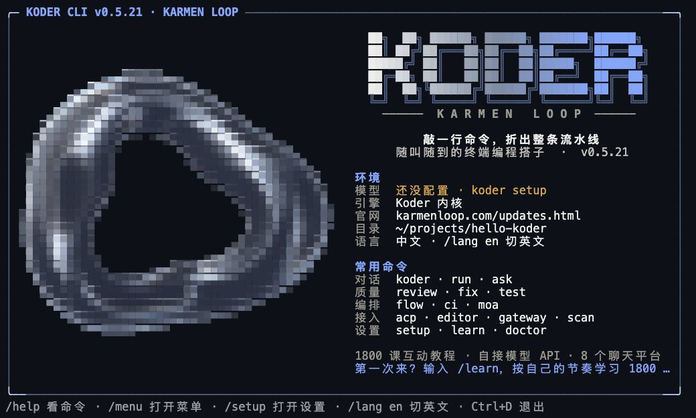
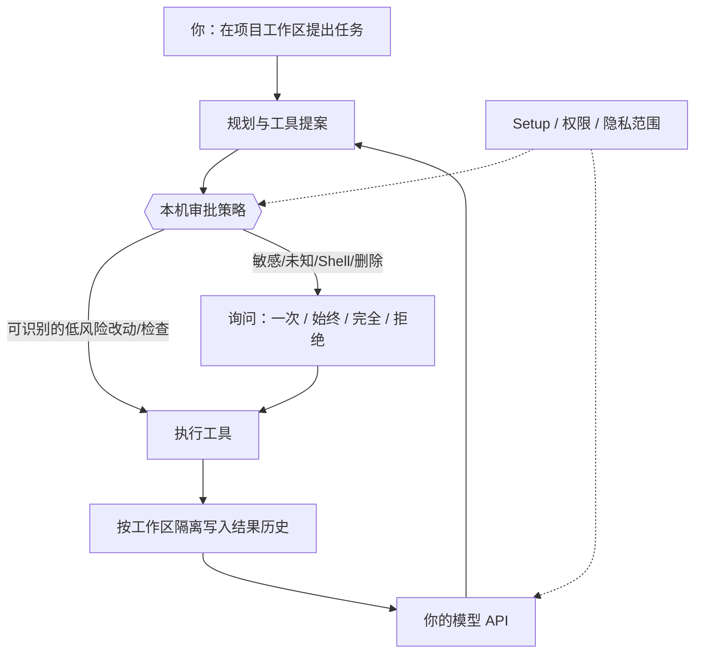
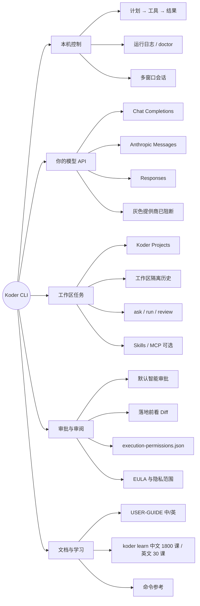
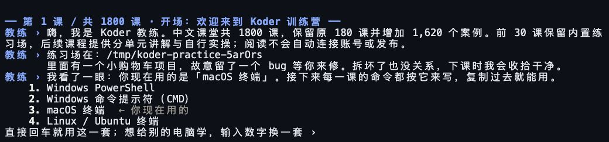
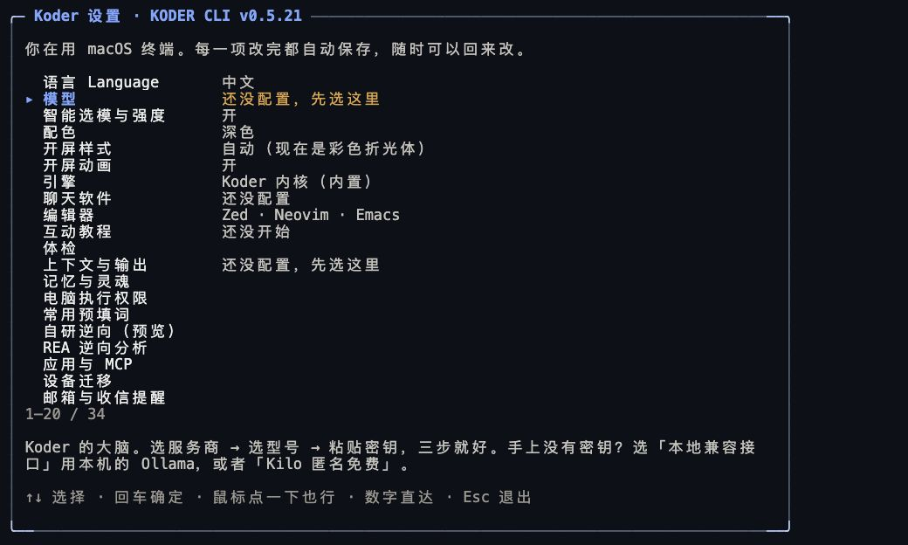

# Koder CLI

安装与下载统一在 [Koder CLI 官网](https://kodermodule.com/) 提供。本仓库保留功能介绍、教程、更新说明与历史记录。

[0.6.2 更新说明](docs/RELEASE-0.6.2.zh.md)。本版已包含[验算与交付记录](docs/AGENT-VERIFICATION.zh.md)中的实现改动；原有质量失败与未验项仍保留。

[Ubuntu 26.04.1 Desktop amd64 完整教程](docs/UBUNTU-26.04.zh.md)

## 安装完成后，怎么进入 Koder？

Ubuntu / macOS：在系统终端逐条执行。先登录 KARMEN；模型已配置时可跳过 setup。

```bash
"$HOME/.local/bin/koder" login
"$HOME/.local/bin/koder" setup
"$HOME/.local/bin/koder"
```

看到 `koder >` 后才输入任务。`activate` 只开启后台常驻，不会进入聊天；出现状态 JSON 后运行最后一条即可。完整路径能用但 `koder` 找不到时，按 [PATH 排查](docs/UBUNTU.zh.md#progress) 操作，不必重新下载。自定义安装路径以安装器末尾为准。


**当前版本：0.6.2。新增浏览器或二维码登录、本机功能修复沙箱，并修复账号检查期间的取消和引导。**

[KARMEN 登录教程](docs/ACCOUNT-LOGIN.zh.md) · [English sign-in guide](docs/ACCOUNT-LOGIN.md) · [目标与计划](docs/GOALS-AND-PLANS.zh.md) · [命令等待](docs/COMMAND-DURATION.md) · [界面与网站设计](docs/INTERFACE-COMPOSITION.zh.md) · [上下文管理](docs/CONTEXT-CONTROLS.zh.md)

通过 CLI 官网安装和更新；保留现有配置与历史。取消、费用预算、权限及未核实结果保护继续有效。

[报告未完成任务](docs/ERROR-REPORTS.zh.md) · [English guide](docs/ERROR-REPORTS.md) · [本版更新](docs/RELEASE-0.6.2.zh.md)

[本机修复教程](docs/SELF-REPAIR.zh.md) · [English guide](docs/SELF-REPAIR.md) · [有限修复许可](LOCAL-REPAIR-PERMISSION.md)

本机功能修复默认关闭，仍支持原有七个模块。候选检查与启用后的函数统一运行在 QuickJS-WASM 沙箱，保留测试和回滚；内核、账号、权限、预算和更新器不在补丁范围内。原有质量目标及平台实机未验项继续保留，见[本版记录](docs/RELEASE-0.6.2.zh.md)。

[邮箱绑定与恢复教程](docs/MAIL-RECOVERY.zh.md)

[完整功能与教程导航](docs/FEATURES.zh.md) · [本版更新](docs/RELEASE-0.6.2.zh.md) · [会话解卡手把手教程](docs/SESSION-RECOVERY.zh.md) · [Windows 磁盘排查手把手教程](docs/WINDOWS-DISK-RECOVERY.zh.md)

[Ubuntu 中文教程](docs/UBUNTU.zh.md) · [全部平台安装](docs/INSTALLATION.md) · [教程总入口](docs/START-HERE.zh.md)

| 你要做什么 | 直接入口 |
| --- | --- |
| Ubuntu 24.04 / 24.04.x 首次安装 | [下载、进度、模型配置和第一个任务](docs/UBUNTU.zh.md#install) |
| 让 Koder 操作 Ubuntu 图形应用 | [依赖、权限、文本编辑器实操](docs/UBUNTU.zh.md#desktop) |
| Ubuntu 下载慢、任务一直等待、密钥环失败 | [按现象排查](docs/UBUNTU.zh.md#troubleshooting) |
| Windows / macOS 安装或升级 | [选择对应终端](docs/INSTALLATION.md) |
| 继续完整课程 | [1800 课中文课堂说明](docs/courses/README.zh.md) |


[English](README.md) · [简体中文](README.zh-CN.md) · **v0.6.2**

[](https://github.com/KarmenLoop/koder-cli/actions/workflows/windows-installer.yml)
[](https://nodejs.org/)
[](EULA.md)
[](docs/INSTALLATION.md)


**本地终端编程 Agent：用你自己的模型 API，在本机完成规划、提案与落地——敏感改动先审批，任务历史按工作区隔离。**

Koder CLI 是 [KARMEN LOOP](https://karmenloop.com) 团队的**本地任务工具**。接入你自己的服务商密钥或受支持的本地模型，选定项目，按计划 → 工具 → 审批 → 结果留存推进工作。**个人非商业本地使用免费，不需要会员，也不需要邀请码。** 执行任务前需要登录 KARMEN 账号；模型 API 另行配置。 商业使用与组织部署须另行取得书面授权。模型/API 费用由服务商另行计收。

当前版本：**0.6.2** · 协议：**[Koder-EULA-1.1](EULA.md)** · 安装：[GitHub 安装指南](docs/INSTALLATION.md)

> 从 0.4.4 或更早升级：若旧更新器因包体积拒绝清单，请用当前官方安装器覆盖升级一次，配置与历史会保留。[安装与升级说明](docs/INSTALLATION.md)。



*历史参考：0.5.21 已发布 macOS 包的启动界面，来自隔离 PTY 的真实 ANSI 输出；此时尚未配置模型。各终端的字体和间距可能不同。*

[安装教程](docs/INSTALLATION.md) · [完整中文指南](docs/USER-GUIDE.zh.md) · [English guide](docs/USER-GUIDE.en.md) · [本版更新](docs/RELEASE-0.6.2.zh.md) · [命令参考](docs/COMMAND-REFERENCE.zh.md)

---

<details>
<summary>近期更新记录（展开）</summary>

> 0.5.12 修复等待模型时过早超时，增加下载 MB、百分比与耗时，并修复整盘授权误拦项目文件的问题。现有功能保留。见[发行说明](docs/RELEASE-0.5.12.zh.md)。

> 0.5.10：macOS / Linux 自动选择较小安装包，支持断点续传、有限重试和 SHA-256 校验。当前系统支持的功能、内置 Skills 和完整课堂保留，完整离线包仍可下载。见[安装与下载恢复](docs/DOWNLOADS.zh.md)。

> 0.5.9 默认加载内置学习方法，补齐学习工具参数示例，并修复续做任务时交付检查工具被隐藏的问题。[更新说明](docs/RELEASE-0.5.9.zh.md) · [学习开关与恢复](docs/MARKDOWN-LEARNING.zh.md)。

> 0.5.8 修复后台邮件提醒恢复、发件结果未核实却被标为完成，以及终端选稿无法记录的问题。[更新说明](docs/RELEASE-0.5.8.zh.md) · [邮箱教程](docs/MAIL-RECOVERY.zh.md)。 [Ubuntu 完整版说明](docs/UBUNTU.zh.md)。

> 0.5.7 修复邮箱锁竞争、发件恢复与查信刷新，并校准网站交付检查。[更新说明](docs/RELEASE-0.5.7.zh.md) · [邮箱使用与排查](docs/MAIL-RECOVERY.zh.md)。

> 0.5.6 补强任务完成与网站交付：明确未完成原因、有界恢复、核对当前文件和实际预览地址。[更新说明](docs/RELEASE-0.5.6.zh.md) · [网站流程](docs/website-delivery.md)。

> 0.5.5 默认保存本地 Markdown 任务记忆，并在 CLI 会话内或下次任务时复盘。已有关闭选择继续生效；可在 Setup 或 `koder learning off` 单独关闭，`koder growth off` 一并暂停。[更新说明](docs/RELEASE-0.5.5.zh.md) · [任务记忆指南](docs/MARKDOWN-LEARNING.zh.md)。

> 0.5.4 按模型、接口与协议提供思考档位，修复子任务强度继承，并保留达到输出上限的正文；符合条件时最多进行两次纯文本续答，取消与费用预算继续生效。[更新说明](docs/RELEASE-0.5.4.zh.md) · [操作指南](docs/MODEL-EFFORT-AND-OUTPUT.zh.md)。

> 0.5.3 细化启动折光体、统一细蓝边框，并修复窄终端菜单宽度；常驻输入、引导和排队保持原有行为。[更新说明](docs/RELEASE-0.5.3.zh.md)。

> 0.5.2 增加原生 JS/TS 代码导航与能力路由，并修复 MCP 别名及可选服务发现。[更新说明](docs/RELEASE-0.5.2.zh.md)。

[从这里开始：安装、更新与全部功能教程](docs/START-HERE.zh.md)

</details>

## 为什么需要它

许多终端 Agent 要么藏起将要改动的内容，要么把模型建议直接当成许可。已经自费接入模型 API 的人，不该再被第二道会员门槛挡住本地客户端；敏感编辑、删除或 Shell 副作用落地前，也应该能看清**将要执行什么**。

Koder 把四件事钉死：

1. **模型归你，账单归你** — 支持 Chat Completions、Anthropic Messages、Responses；目录在历史条目旁标明当前可用性。网页会员**绝不**被默认等同于 API 权限。
2. **本机控制面** — 在 KARMEN LOOP 内核叙事下，本机完成规划、权限检查、工具执行与结果留存。执行授权按哈希与范围保存，**不会**被同步成「记忆」。
3. **默认智能审批** — 可识别的低风险本地检查与普通工程改动可免问；代码执行、删除、密钥/配置路径、Shell 副作用、未知命令与外部应用动作会询问。判定来自**本地策略代码**，不是模型口头声明。
4. **边界写清楚** — 已知故障的提供商条目保持灰色不可选；未跑过的 Windows 原生 GUI / ConPTY / 真实邮箱 / 模型质量路径在发行证据里标为 **NOT_RUN**。

本机 fixture **不能**证明每台电脑、每个真实账号或模型质量分数都已验收。

---

## 一览

| | |
|---|---|
| **安装什么** | 官方 Windows / macOS / Linux 安装器分发的版本化 CLI 运行时（Node **^22.21.0 或 ≥24**，复用或下载并校验） |
| **你自备什么** | 自己的模型 API Key，或受支持的本地模型端点 |
| **版本** | **0.6.2**（官网发行清单、stable 通道） |
| **本版许可** | **Koder-EULA-1.1** — 当前应用运行时的专有终端用户许可 |
| **个人使用** | 个人非商业本地使用免费 — **无会员、无邀请码** |
| **商业 / 组织** | 须事先书面授权（`koder business` / [商业授权](docs/COMMERCIAL-LICENSING.md)） |
| **项目** | 新建网站 / 演示稿 / 应用默认进入 **Koder Projects**；`-w` 或已有工程优先 |
| **历史** | 任务历史与自动捕获事实按**工作区隔离**；`default` 表示*该工作区*的默认会话 |
| **任务记忆** | 默认开启本地 Markdown 记录，按账号、工作区与任务会话隔离；`koder learning status` 查看，`koder learning off` 暂停 |
| **互动教程** | `koder learn` — 中文 1800 课，含原 30 课离线教练与英文版；PowerShell / CMD / macOS / Linux；阅读与教练不调用付费模型 |
| **可选能力** | Portable Skills、Harness、常驻、邮件问询、Windows-MCP / 代码图谱、彩蛋动画等 |
| **公开仓库树** | 保留历史 **GPL 0.3.1** 源码；**不能**用该树构建本专有安装包（[源码状态](SOURCE-STATUS.md)） |

---

## 是 / 不是

| 是 | 不是 |
|---|---|
| 自接模型 API 的本地**终端编程 Agent** | 托管编程 SaaS，或捆绑付费模型额度 |
| 个人非商业本地免费使用（无会员） | 未经书面授权的商业 / 组织部署许可 |
| 智能审批 + Diff 审阅后再敏感落地 | 操作系统沙箱或管理员提权 |
| 按工作区隔离的任务历史与项目目录 | 把所有仓库事实混在一个全局聊天里 |
| 官方安装器 + SHA-256 校验 + 明确 `accept` | 空回车静默接受许可（空输入会再问） |
| 已知故障提供商灰显并阻断联网 | 静默切换计费路线或自动「备用引擎」 |
| 文档中诚实标注 NOT_RUN 的原生/账号项 | 用 macOS fixture 冒充 Windows GUI 或模型质量验收 |
| 支持的配置 / Skill / MCP 扩展面 | 修改或再分发专有运行时源码的权利 |
| 执行授权记录失败关闭（`execution-permissions.json`） | 从损坏或部分授权文件静默恢复权限 |
| 常驻、邮件、远程资料、彩蛋均为显式开启 | 仅因接受 EULA 就打开这些能力 |

---

## 架构

三层刻意分开。模型负责提案；本机策略负责裁决；工作区负责留存。

1. **客户端与会话** — 交互聊天、可编辑 `/` 预选项、忙时 steer/queue、多窗口任务会话、有界私有运行日志（`koder logs`、doctor）。排队文本**不能**批准待处理的敏感提示。
2. **控制面** — 计划 → 本地权限策略 → 工具执行 → 结果留存。授权按动作哈希，范围为本工作区（或带确认的显式 profile），保存在本机 CLI 目录的 `execution-permissions.json`，**不同步成会话记忆**。
3. **你的模型与工具** — 你配置的 Chat Completions / Anthropic Messages / Responses。可选 MCP / Skills / 应用须各自设置与授权。协议兼容**不等于**每个第三方服务已验收。



**隔离说明。** 会话名 `default` 表示**该规范工作区**的默认会话，不是跨所有目录的全局聊天。私有会话记录在用户 Koder 配置区，按工作区与会话索引——不会放进将来上传的公开网站目录。

---

## 产品思维导图

一张图看清各块怎么咬合：控制面在本机，模型归你，敏感落地先审批。



---

## 界面截图 · 0.5.21 历史参考

以下保留旧版本实拍，不冒充 0.6.2 新截图。当前行为和验收限制见 0.6.2 更新说明。

以下图片来自已发布的 macOS 版本，分别展示启动界面、设置菜单和第一课。中英文 README 各用对应语言的实测画面。

| 界面 | 图中内容 | 图片 |
| --- | --- | --- |
| 启动 | 折光体、版本、工作目录与常用命令 | [启动界面](docs/screenshots/cli-start-0.5.21-zh-dark.jpg) |
| 设置 | 尚未配置模型时的主菜单 | [设置菜单](docs/screenshots/cli-setup-0.5.21-zh-dark.jpg) |
| 课堂 | 第一课的终端选择步骤 | [第一课](docs/screenshots/cli-learn-0.5.21-zh-dark.jpg) |

图片采集于 2026 年 10 月 30 日，由程序的真实终端输出渲染而成。采集方式与校验值见[截图说明](docs/screenshots/README.zh-CN.md)；安装和首个任务见[手把手上手](#手把手上手)。

---

## 能力一览

| 领域 | 你得到什么 | 边界在哪 |
|---|---|---|
| **聊天与 Agent** | 交互 `koder`、`ask`、`run`、工作模式、可编辑 `/` 选项、忙时 steer 或 queue | 模式不是权限；排队文本不能批准待处理提示 |
| **项目** | `koder project create|list|status`、`/project`、Koder Projects 主目录 | 不会把工程文件散落到程序安装目录 |
| **交付检查** | 本轮产物 / 格式 / 回执检查，有界修复 | 不是编码或文案质量分（[TASK-DELIVERY](docs/TASK-DELIVERY.zh.md)） |
| **可视化工作流** | 完整制作前三方向 HTML；伴随 `/preview`；交付时 H5 结构图 | 浏览器原型 ≠ 原生真机验收（[可视化与 Netlify](docs/VISUAL-WORKFLOW-AND-NETLIFY.md)） |
| **Skills 与 MCP** | 可移植技能、按需目录/读取、兼容清单 | 协议兼容 ≠ 每个第三方服务已验收（[清单](docs/MCP-SKILL-INVENTORY.md)） |
| **成长方法** | 内置 `personal-agent-growth`，`koder growth status|show|on|off` | 默认不开画像同步、后台服务或新的 API 预算（[说明](docs/AUTONOMOUS-LEARNING.md)） |
| **常驻与邮件** | 可选 `koder activate` / `status` / `deactivate`；问询 → 草稿 → 确认发送 | 默认关闭；广告/验证码不参与（[ALWAYS-ON](docs/ALWAYS-ON.zh.md)） |
| **Windows 深度** | 可选 Windows-MCP + 代码图谱；Windows 包内含 x64 运行时 | GUI / 冷安装路径可能仍为 NOT_RUN（[MCP-INTEGRATIONS](docs/MCP-INTEGRATIONS.zh.md)） |
| **彩蛋** | 可选 `koder celebrate`；尊重减弱动态 | 接受许可不会开启生日、音乐或国家查询 |

---

## 安装

请使用匹配的 **Windows 10/11**、**macOS**、**Linux** 或 **WSL** 终端。正常安装**不需要**管理员权限。输入 `accept` 前请阅读 [EULA](EULA.md)、[同意与数据说明](ACCEPTANCE.md)、[版权声明](LEGAL-NOTICE.md) 与 [CLI 隐私](docs/privacy/consumer-privacy.zh.md)。

只选**一条**命令。等到 `accept / decline:`，输入 `accept` 并回车。`decline` 或 Ctrl+C 取消。Windows 上空回车会再问 — **不会**接受许可。接受许可**不会**开启电脑、邮件、画像学习、同步、生日、音乐或国家查询等可选项。

安装与许可提示的操作说明见[手把手第 1 步](#1-安装并接受-eula)。

### 在 CLI 官网选择系统

打开 [Koder CLI 官网](https://kodermodule.com/)，选择 Windows、macOS 或 Ubuntu/Linux，使用对应终端的安装命令，等待下载与摘要校验完成后按提示接受许可。安装命令和安装包下载统一在官网维护。

安装成功后，新开终端依次运行：

```text
koder --version
koder setup
koder
```

当前正式版为 **0.6.2**。若提示找不到 `koder`，[Ubuntu PATH 教程](docs/UBUNTU.zh.md) 包含通过安装后的完整路径启动、刷新终端环境的步骤。图形操作还需要对应依赖与授权。平台细节见 [安装教程](docs/INSTALLATION.md)。

---

## 开始使用

安装并新开终端后：

```text
koder setup
koder learn
koder
```

- `koder setup` — 接入模型 API（真实任务前必做）。
- `koder learn` — 可选 30 课教练，临时练习工程；**不调用付费模型**。
- `koder` — 在当前工作区进入交互聊天。

更希望按步骤走到第一次成功？直接跟下文 [手把手上手](#手把手上手)。

---

## 手把手上手

从零到「看过 Diff、主动批准或拒绝」的第一次成功路径。更深工作流（项目、预览、Netlify、邮件、常驻）见 [完整中文指南](docs/USER-GUIDE.zh.md) 与 [English guide](docs/USER-GUIDE.en.md)——**仅靠本节**即可完成：安装 → 配置 → 跑一题 → 读 Diff → 决定。

### 1. 安装并接受 EULA

1. 打开 [Koder CLI 官网](https://kodermodule.com/)，选择对应系统与终端的安装入口。
2. 等到进度结束，提示精确显示：`accept / decline:`。
3. 输入 `accept` 并回车。输入 `decline` 或按 Ctrl+C 取消。Windows 上空回车会**再问一次**——不会接受。
4. 安装结束后**关掉终端再开**，让 `PATH` 生效。

### 2. 核对版本并进入会话

```text
koder --version
koder
```

应看到 **0.6.2**。首次任务前运行 `koder login`，在官方账号页面核对并批准设备。[登录教程](docs/ACCOUNT-LOGIN.zh.md)涵盖扫码、退出、Linux 凭据存储与无头任务。直接 `koder` 进入交互聊天。想先走短教程？

```text
koder learn
```

课中：`Enter` 继续，`b` 回退，`q` 离开。离线文本版：`koder learn --print --os mac --lang zh`（`--os` 也可为 `powershell` / `cmd` / `linux`；`--lang en` 为英文）。



*第一课先让你选择使用的终端。本图停在选择步骤，阅读课程不需要调用模型。*

### 3. 配置模型 API 并选定项目

```text
koder setup
```

在 setup 中请按序确认：

1. 选择**可用**（非灰色）的服务商条目。
2. 填入账号实际下发的模型 ID、协议与端点。
3. 若不想把 Key 值写入配置，优先用环境变量引用；切勿把 Key 贴进任务、截图或 Issue。
4. 网页会员**不等于** API 权限。

接着创建或选定项目。新建网站 / 演示稿 / 应用默认进入用户主目录下的 **Koder Projects**，除非指定 `-w` 或继续已有工程：

```text
koder project create "Studio Site" --kind website
koder project create "Quarterly Review" --kind slides
koder project create "Studio App" --kind app
koder project list --json
koder project status
koder chat -w /absolute/path/to/existing-project
```

聊天内：`/project create "Another Site" --kind website` 创建并选中；`/project open "/absolute/path"` 回到已有目录。同名冲突会被拒绝——**不会**合并文件。



*尚未配置服务商时的设置主菜单。选择「模型」后填写服务商配置。*

准备好后可做通烟测试（可能产生服务商费用）：

```text
koder model presets
koder model test
koder model test --tools
```

`model test` 使用短诊断预算；文字回复只证明文本通路。`--tools` 会请求无害工具调用与续答。

### 4. 下达首个任务并阅读 CLI Diff

在聊天里给出具体、边界清楚的请求——例如解释某个文件、给 README 加一小段、或修本地失败检查。也可在 Shell：

```text
koder ask "Explain the architecture of this project" --lang en
koder run "给 README 加一段本地启动说明" --lang zh
```

| 命令 | 行为 |
|---|---|
| `ask` | 只回答、**不**提出文件修改 |
| `run` | 可能在审批策略下提出工具调用 |
| `--mode plan\|code\|execute\|…` | **工作模式**，不是权限授权 |
| `--session name` | **本工作区内**的命名会话 |
| `--new` / `--no-memory` | 新话题 / 本次不带已存任务历史 |

当 Agent 提出工程改动时，**批准前先看 CLI Diff**：

1. 路径——是否落在意图内的项目？
2. 删除——有意为之，还是连带误伤？
3. 密钥 / 配置——是否靠近 Key、`.env`、凭据或发布配置？
4. 范围——hunk 是否贴合请求，还是漂移到无关文件？

### 5. 可选：在 TUI 里再看同一处改动

若更习惯全屏视图，打开 TUI Diff。说明与 hunk 与 CLI 一致——同一工作区、同一套策略。批准或拒绝时与 CLI 同样谨慎。

### 6. 批准或拒绝——然后可选用 review

敏感提示时：

| 输入 | 效果 |
|---|---|
| **y** | 仅允许**本次**动作一次 |
| **a** / `always` | 将该**精确**动作保存到本工作区 |
| **f** / `full` | 本工作区完全访问（或带确认的 `--scope profile`） |
| Enter / **n** | 拒绝 |

拒绝是一等公民结果。未知结果不等于成功——在重试发送、支付或发布前，先核实现状。

接受之后，改动写入按工作区隔离的历史。若要做结构化审查：

```text
koder review
koder review --format json
```

适合在落地后需要结构化发现、大改动跟进前，或 CI 式门禁必须区分「解析干净」与失败时使用。若模型回答成功仍无法解析出完整审查结果，CLI 以退出码 **3** 返回 `REVIEW_UNPARSED`——**不要**把它当成干净通过。

**第一次成功**的标志：版本显示 0.6.2、KARMEN 登录完成、setup 里有可用（非灰）服务商、至少一题产生可读 Diff、你主动批准或拒绝。多窗口、Skills/MCP、常驻、邮件问询等继续看 [完整中文指南](docs/USER-GUIDE.zh.md)。

日常聊天：空提示符输入 `/` 打开可编辑选项（Tab 填入，Esc 关闭，填入后再 Enter 发送）。`/setup` 打开设置，`/model` 管理模型，`/new` 新话题，`/exit` 离开。`/menu` 也可打开设置。

---

## 安全：审批、Diff 与权限

默认智能审批：可识别的低风险本地检查与普通工程改动可免问；代码执行、删除、密钥或配置路径、Shell 副作用、未知命令与外部应用动作会**询问**。判定由本地策略代码计算——**不**采信模型对风险的口头描述。

这是**审批策略**，不是操作系统沙箱。它不会提权、不会绕过辅助功能提示，也不能替代服务商自身的安全模型。

敏感提示时：**y** 允许一次，**a** / always 保存该精确动作到本工作区，**f** / full 保存本工作区完全访问（或带确认的 `--scope profile`），Enter / **n** 拒绝。

```sh
koder permissions execution status
koder permissions execution ask
koder permissions execution auto
koder permissions execution full --confirm FULL
koder permissions execution full --scope profile --confirm FULL
koder permissions execution revoke all
koder permissions execution reset
```

| 控制项 | 作用范围 |
|---|---|
| `ask` / `auto` / `full` | 工作区（或带确认的 profile）的持久执行策略 |
| `revoke all` | 本工作区回到智能模式，并移除适用的已存规则 |
| `reset` | 清除全部已存执行设置 |
| `--approval auto\|ask\|full\|deny` | **仅本次运行** |
| `--yes` | 临时便利；**不能**覆盖显式 deny、代接受 EULA、代填密码或授予系统辅助功能权限 |

规则保存在本机 CLI 目录的 `execution-permissions.json`（主机/工作区范围 + 动作哈希——不是原始命令或密钥）。损坏记录**失败关闭**：Koder 会重新询问，不会静默恢复宽权限。执行权限不会被同步成记忆。

隐私与反馈可离线阅读：

```text
koder privacy consumer
koder privacy statement
koder privacy desktop
koder privacy agreement
koder privacy sources
koder feedback
koder permissions status
```

`koder feedback` 只给出 **info@karmenloop.com** 与空白模板 — **不会自动发送或附加任何内容**。发送前请去掉 Key、密码、私有路径与个人记录。

---

## 模型与服务商

在 `koder setup` 或显式 profile 命令中配置。请守住三条边界：

1. **计费** — Koder 不替代服务商计费。网页会员 ≠ API 权限。
2. **协议** — Chat Completions、Anthropic Messages、Responses。目录可保留历史条目，但每条旁会标明**当前可用性**。
3. **无静默回退** — 独立套餐条目保持独立主机、密钥与计费路径。内部备用引擎默认禁用且灰显。

```text
koder model presets
koder model models aliyun-coding-plan
koder model test
koder model test --tools
koder model set --model ACTUAL_MODEL_ID --base-url OFFICIAL_API_BASE --protocol openai --key-env MY_PROVIDER_KEY
```

详见 [PROVIDERS.md](docs/PROVIDERS.md)、[MIMO.md](docs/MIMO.md)。

**暂时不可用（灰色，联网前阻断）：** MiMo Token Plan、Kimi API、Kimi Code、DeepSeek、阿里云 Token Plan、火山 Coding Plan、火山方舟 API。已有配置可查看或删除；激活、测试、刷新与执行保持阻断。不会自动切换计费路线。

---

## 保留功能：SolidCraft CAD

内置 SolidCraft 0.23.0：在当前项目用 `koder cad enable` 启用，`koder cad test` 检查连接；通过原有工具、审批与模型配置完成参数化建模、测量、保存和导出。每轮使用独立无界面设计，跨轮先保存再打开。原有邮箱、Skills、不限工具轮次、取消和费用预算继续保留。[CAD 教程](docs/SOLIDCRAFT.zh.md) · [更新说明](docs/RELEASE-0.4.19.zh.md)。

---

## 私有资料与公司授权

远程资料默认**关闭**。可用 `koder resources search "关键词" --remote` 为单次命令授权，或设 `KODER_REMOTE_RESOURCES=1` 向 Agent 提供远程工具（`0` 强制关闭）。本机归档用 `koder resources import` 导入 — 原件留在本地；见 [REMOTE-RESOURCES](docs/REMOTE-RESOURCES.md)、[PRIVATE-RESOURCES](docs/PRIVATE-RESOURCES.md)。

公司授权与专用私有仓库：`koder business` 或 [info@karmenloop.com](mailto:info@karmenloop.com)。范围以另行书面协议为准；点星与咨询邮件本身不构成授权（[商业授权](docs/COMMERCIAL-LICENSING.md)）。

---

## 更新

符合条件的托管交互聊天会在启动时检查正式更新源，运行期间每六小时周期检查，并在任务、队列与草稿空闲后交接。许可变更须重新阅读。

```text
koder update --check
koder update
koder update auto status
koder update auto off
koder update auto on
```

`KODER_AUTO_UPDATE=0` 对本进程关闭自动检查。脚本与一次性命令不会自动安装。详见 [自动更新](docs/AUTO-UPDATE.zh.md)。

---

## 文档地图

| 需求 | 从这里开始 | 这份文档解决什么 |
|---|---|---|
| 安装与首个模型 | [INSTALLATION.md](docs/INSTALLATION.md) | 各平台终端、Node 复用/下载、EULA 接受与恢复 |
| 完整工作流（中 / 英） | [USER-GUIDE.zh.md](docs/USER-GUIDE.zh.md) · [USER-GUIDE.en.md](docs/USER-GUIDE.en.md) | 超出「第一次成功」的完整产品叙事 |
| 全部已文档化命令 | [COMMAND-REFERENCE.zh.md](docs/COMMAND-REFERENCE.zh.md) · [en](docs/COMMAND-REFERENCE.en.md) | 生成式命令与全局选项参考 |
| 服务商与协议 | [PROVIDERS.md](docs/PROVIDERS.md) | 端点、灰色路线、密钥安全处理 |
| 忙时输入、steer/queue、技能界面 | [SESSION-INPUT-AND-SKILLS](docs/SESSION-INPUT-AND-SKILLS.zh.md) | 忙时输入与按需加载技能 |
| 可脚本化合约与退出码 | [CLI-CONTRACTS.zh.md](docs/CLI-CONTRACTS.zh.md) | stdin、澄清、审批与非零退出含义 |
| 多窗口会话 | [MULTI-WINDOW.md](docs/MULTI-WINDOW.md) | 独立终端任务会话 |
| 常驻 / 邮件问询 | [ALWAYS-ON](docs/ALWAYS-ON.zh.md) · [MAIL-PROACTIVE-INQUIRY](docs/MAIL-PROACTIVE-INQUIRY.zh.md) | 可选常驻与邮件草稿 → 确认发送 |
| MCP / Skill 清单 | [MCP-SKILL-COMPATIBILITY](docs/MCP-SKILL-COMPATIBILITY.zh.md) · [inventory](docs/MCP-SKILL-INVENTORY.md) | 开关、依赖与已验证边界——不是每个 SaaS 的验收证明 |
| 内置自主学习方法 | [AUTONOMOUS-LEARNING.md](docs/AUTONOMOUS-LEARNING.md) | `personal-agent-growth` 如何挂接且不新增预算 |
| 排障 | [TROUBLESHOOTING.md](docs/TROUBLESHOOTING.md) | 安装卡住、灰色提供商、常见失败 |
| 分发与历史 GPL 树 | [DISTRIBUTION.md](DISTRIBUTION.md) · [SOURCE-STATUS.md](SOURCE-STATUS.md) | 专有运行时 vs 历史公开树 |
| 中文 1800 课 / 英文 30 课文本 | [docs/tutorials/](docs/tutorials/) | 中英 × PowerShell/CMD/mac/linux 离线版 |
| 本地任务记忆（默认开） | [MARKDOWN-LEARNING.zh.md](docs/MARKDOWN-LEARNING.zh.md) | 范围、实际开关、复盘与关闭方法 |
| 本版发行 | [RELEASE-0.6.2.md](docs/RELEASE-0.6.2.zh.md) | 改了什么、哪些仍为 NOT_RUN |

---

## 验收边界（诚实写明）

发行证据区分：**源码/fixture 检查**、**已安装协议 fixture**、**托管原生 Windows**、**真实服务商账号**、**用户设备**。无密钥本地回归用脚本化提供商验证 CLI 行为；**不能**证明 PowerShell 5.1 冷启动安装、ConPTY/IME、Windows-MCP GUI、邮箱投递或模型质量。这些项在 [0.5.2 说明](docs/RELEASE-0.5.2.zh.md) 与 [Windows 安装检查](docs/WINDOWS-INSTALL-CHECKS.md) 标为 **NOT_RUN** 处保持未验。

可用安装包、安装器与校验和由 **CLI 官网** 发布。本仓库保留发行说明、项目文档和历史记录；专有运行时开发源码保持私有。

---

## 常见问题

**安装需要邀请码或付费会员吗？**\
不需要。个人非商业本地使用在 Koder-EULA-1.1 下免费，无须会员。商业与组织使用须另行书面授权。

**Koder 用谁的模型 API？**\
用你的。在 setup 里配置服务商。Koder 不替代服务商计费。部分目录条目暂时灰色并阻断（见 [模型与服务商](#模型与服务商)）。

**会不会不经询问就改我的文件？**\
可识别的低风险本地检查与普通工程改动可按智能审批执行。敏感或未知效果——含删除、密钥路径、Shell 副作用——会先询问。批准前请看清 Diff 与目标。

**公开 GitHub 源码就是 0.6.2 运行时吗？**
不是。公开树保留历史 GPL **0.3.1** 材料。**0.6.2** 应用运行时为专有，经官方安装器与发行清单分发（[SOURCE-STATUS.md](SOURCE-STATUS.md)）。

**公司能否部署？**\
联系 [info@karmenloop.com](mailto:info@karmenloop.com) 或运行 `koder business`。点星、下载与咨询邮件本身不构成商业授权。

**项目和私有历史放在哪里？**\
新建任务默认进入用户主目录下的 **Koder Projects**，除非指定 `-w` 或继续已有工程。私有会话记录在用户 Koder 配置区，按工作区与会话索引 — 不会放进将来上传的公开网站目录。

**什么时候该跑 `koder review`？**\
落地后需要结构化发现时、大改动跟进前，或门禁必须区分干净解析与 `REVIEW_UNPARSED`（退出码 3）时。它**不能**替代首次批准前阅读 Diff。

**手把手教程在哪？**\
就在本页：[手把手上手](#手把手上手)（含当前版本的启动、设置和课堂图片）。完整深度：[USER-GUIDE.zh.md](docs/USER-GUIDE.zh.md) · [USER-GUIDE.en.md](docs/USER-GUIDE.en.md) · `koder learn`。

---

## 许可与联系

- 当前发行：[EULA.md](EULA.md)（Koder-EULA-1.1）· 范围说明：[LICENSE](LICENSE)
- 第三方：[THIRD_PARTY_NOTICES.md](THIRD_PARTY_NOTICES.md) · [OPEN_SOURCE_CREDITS.md](OPEN_SOURCE_CREDITS.md) · [licenses/](licenses/)
- 内置方法包保留各自许可（例如随附的未修改 `personal-agent-growth` 方法在适用处仍为 AGPL-3.0-only）

KARMENLOOP 官方团队 · 中国上海 · [karmenloop.com](https://karmenloop.com) · [info@karmenloop.com](mailto:info@karmenloop.com)

如果觉得有用，欢迎自愿 [点个星](https://github.com/KarmenLoop/koder-cli)；跳过完全不影响安装与已授权功能。


## 1800课深度跟做课堂

课堂版 2026.10.26.1：120个单元、1800份工作簿、12类实操指南和开发者加练。原课号与学习进度保留。先读[跟做指南](docs/courses/PRACTICE-GUIDE.zh.html)，再进入[完整课堂](docs/courses/index.zh.html)。[完整离线教材](https://kodermodule.com/cli-tutorials.html)含逐课空白工作簿；无需重装CLI，结构检查不代替答案核对。


## SolidCraft 参数化 CAD

在独立项目运行 `koder cad enable`、`koder cad verify`、`koder cad test`，再进入 `koder`。每轮独立设计，保存 `.solidcraft` 后可在下一轮打开继续修改。完整尺寸、测量、导出和故障处理见 [手把手 CAD 教程](docs/SOLIDCRAFT.zh.md)。安装包、教程与更新清单由 CLI 官网统一发布。


## Awesome LLM Apps · 0.4.20

146个离线应用/教程条目、7项原生改写方法和5个可调用工具，默认融入现有模型、工具、权限与预算。用 koder llm-apps status 查看，用 koder llm-apps off 关闭。上游服务和依赖不自动安装或开通。

[完整手把手教程](docs/AWESOME-LLM-APPS.zh.md) · [全部条目](docs/AWESOME-LLM-APPS-CATALOG.md) · [更新内容与验收边界](docs/RELEASE-0.4.20.zh.md)。


## 自寻 Skill 与子任务 · 0.4.21

指定 GitHub 仓库查找、固定 commit 安装、读完继续原任务；独立子任务沿原 Core 运行并返回文件与工具回执。工具轮次默认不限，取消和费用预算继续生效。180 是未收集子任务名额上限。[中文手把手教程](docs/SELF-FETCH-AND-SUBAGENTS.zh.md) · [实际调用证据及未验边界](docs/ORCHESTRATION-ACCEPTANCE.md)。


## 网站需求与设计 · 0.4.22

新建或改版网站时，先补齐缺失目标、读者、动作、页面和素材；沿随包设计参考确定本项目样式，再完成代码、检查、预览与 H5 结构图。默认开启，可通过 Setup 或 koder design off 关闭。[中文手把手教程](docs/AWESOME-DESIGN-MD.zh.md) · [English guide](docs/AWESOME-DESIGN-MD.en.md)。


## 网站项目与标准锚点 · 0.4.23

默认通过 Fullstack Web Delivery 了解需求，再围绕稳定项目方向实施、测试和预览。新项目单独建目录；旧站修复保留原目录、编号与已知需求。改变中心思想先列出差异，根据真实用户决定后通过原审批保存。Setup 可单独关闭。[中文手把手教程](docs/WEBSITE-PROJECTS.zh.md) · [English](docs/WEBSITE-PROJECTS.en.md)。


## 文档问答 · 0.4.24

本地 Markdown/文本/PDF 先看目录，再选章节、读原文、核对引用。PDFium 随包携带，无需 Python 或新云账号。Setup → Skills 可关闭；保留原项目、费用预算、取消和权限。扫描件需 OCR，不代表上游 Flash/cloud 或付费模型盲测通过。[中文手把手教程](docs/PAGEINDEX.zh.md) · [English](docs/PAGEINDEX.en.md)。


## 真实调用与专业角色 · 0.5.0

用 koder tools audit 检查工具、Skill、权限和本地资源；通过原 Core 执行并核对回执。Tesseract.js 中英文 OCR 随包携带，无需 Python 或云 OCR 账号。90 个角色覆盖 25 个领域，默认 4 个子任务同时执行，额外 FIFO 排队；180 是任务槽位，不是付费并发保证。headless JSON 会给出明确终态。保留旧 Core、模型/BYOK、取消、费用和项目隔离。[完整操作教程](docs/FRAMEWORK-0.5.zh.md) · [OCR](docs/OCR.zh.md) · [角色目录](docs/SUBAGENT-ROLE-CATALOG.zh.md)。Windows 实机由 beta 验证，专业角色不等于执业资质或已验证的内容质量。


## 上下文设置与自动压缩 · 0.5.1

使用 `koder context status` 查看配置；`koder context set --trigger-percent 85 --target-percent 65 --keep-turns 6` 调整触发与目标占比；`koder context off` 关闭自动压缩。默认开启，80% 触发、60% 目标、优先保留 4 轮。模型窗口与输出上限写回原模型配置，权限、取消、费用预算和本机原始历史继续保留。关闭后超窗会明确报错。主会话、子 Agent 和 MoA 使用同一策略；外部 ACP 引擎仍自管上下文。[手把手教程](docs/CONTEXT-CONTROLS.zh.md)。


## 原生能力与 MCP · 0.5.2

`koder mcp capabilities --json` 查看归属和边界；任务内 `tool_inventory` 只列实际挂载入口。`code_graph` 复用 Koder Reverse Worker 读取 JS/TS 依赖和符号候选，随后仍需读源码核实。高级图谱、Windows 图形操作、REA、SolidCraft 与 MCP SDK 保留上游实现与许可，不以改名冒充原创。长别名与工作区移动时的过滤已修复；可选 REA 失败不再阻断其他工具发现。[详细教程](docs/NATIVE-MCP-CAPABILITIES.zh.md)。


## 0.6.2：账号登录与本机功能修复

运行 `koder login`，通过系统浏览器或终端二维码批准这台 CLI。账号检查期间仍可取消或继续引导。会话令牌使用原生凭据层保存；受保护存储不可用时会报错，不降级为明文令牌文件。[登录与恢复教程](docs/ACCOUNT-LOGIN.zh.md)。

本机功能修复继续由用户选择开启。七个受支持模块沿用测试、启用与回滚流程，生成的函数在 QuickJS-WASM 隔离解释器中执行。[修复教程](docs/SELF-REPAIR.zh.md)。

实际包首次更新检查返回 `NETWORK_FAILED`；后续未改程序、未加载观察器、未覆盖网络的默认复核在 2.24 秒内通过，确认 0.6.2 已是最新版本。原失败保留，其初始根因尚未证实。真人登录、各系统原生凭据、Windows/Ubuntu GUI、真实 163 收发与可见通知，以及独立模型质量题组，本轮均未完成验收。[本版说明与边界](docs/RELEASE-0.6.2.zh.md)。
