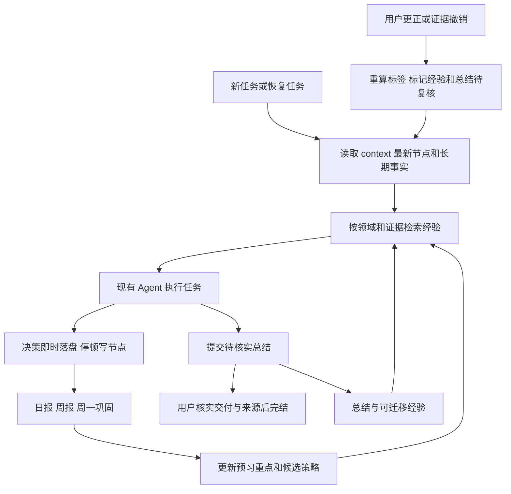

# Koder CLI 的 Markdown 学习库

这项增量把项目记忆、停顿节点、经验条目、行为证据和日周复盘保存为可直接阅读的 Markdown。它接入现有 KARMENLOOP 会话：先读项目包，执行任务，记录决策和结果，保存下一步。没有训练模型权重，也没有新增 Agent 执行循环。

本功能随 0.5.5 提供，默认用于内置 KARMENLOOP 的合资格任务。首次实际任务才建立学习库，帮助、状态查询、设置菜单浏览和只读规划不建库。安装、升级和平台验收以发行附件 ACCEPTANCE-RESULTS.json 为准。


内置方法已更新为 personal-agent-growth 0.4.3；启用时任务入口默认加载有来源哈希的短方法，详细参考用 `skill_read` 读取。任务 JSON 的 `growthMethod` 记录实际加载位置，与真实工具调用、任务通过及质量提升分开陈述，详见[接入说明](AUTONOMOUS-LEARNING.md)。
## 启用与使用

需要 Node.js 22.21 或以上的受支持版本。官方安装器会检查运行环境；下方命令适用于 Koder CLI 0.5.5。先运行 `koder --version` 核对版本。

```sh
cd /absolute/path/to/project
koder learning init
koder learning project my-project -w /absolute/path/to/project \
  --goal "完成工具并验证中断恢复" \
  --criteria "功能检查通过，使用说明齐全" \
  --constraints "保留原始数据与无关改动"
koder run "继续当前项目" -w /absolute/path/to/project --learning-project my-project
koder learning resume my-project
koder learning search "恢复" --tag workflow/read-first
koder learning open my-project-memory
```

显式 `--learning-root`（管理命令也可用 `--root`）或 `KODER_LEARNING_ROOT` 指向准确目录。未指定时，以 `KODER_DATA`、配置中的 `dataHome`、CLI 数据目录为顺序选基础目录，再按账号和工作区哈希隔离到 `learning/accounts/<hash>/workspaces/<hash>`。已有 `~/.koder/learning` 仅在本地账号和工作区相容时复用。每个聊天按稳定会话 ID 创建独立任务项目；同一工作区的两个聊天不互相注入进度。显式 `--learning-project` 才共享指定项目。不同设备的同步和冲突处理不由本地模块提供。

下面示例中的路径需换成已有工程路径；先进入同一工作区，再运行所有学习管理和聊天命令。

Windows PowerShell 示例：

```powershell
Set-Location 'D:\Projects\app-one'
$env:KODER_LEARNING_ROOT = 'D:\KoderLearning'
koder learning init
koder learning project app-one -w 'D:\Projects\app-one' --goal '完善项目'
koder chat -w 'D:\Projects\app-one' --learning-project app-one
```

没有 D 盘可用 `C:\KoderLearning`。macOS 可选择桌面或自己的目录；路径含空格时加引号。根目录选择不会移动现有学习文件。

项目 ID 是稳定身份。学习库另记录账号与工作区归属；移动已绑定的仓库或学习库需要先核对归属，不能把新路径自动当成原项目。目录名称相同不会自动合并项目。完结后需要新阶段时，用 `--reopen --goal "新阶段目标"`；旧总结保留，但不继续作为当前状态。

## 文件布局

```text
learning/
  policy.md
  index.md
  daily/YYYY-MM-DD.md
  weekly/YYYY-Www.md
  weekly/YYYY-Www-consolidation.md
  projects/<id>/
    memory.md
    context.md
    nodes/YYYY-MM-DD-HHMM.md
    nodes/YYYY-MM-DD-HHMM-02.md
    summary.md
    experience.md
  experience/<id>.md
  user/profile.md
  user/behavior-log/YYYY-MM-DD.md
  user/tags.md
  user/preview.md
  _ops/transactions/<id>.md
  _ops/staging/<id>/<relative-path>.md
  _ops/locks/
```

`memory.md` 只保留目标、完成标准、约束、决策、关键路径和禁忌。`context.md` 描述当前位置、开放假设、未决问题和下一步。节点保存本次进度、尝试、判断变化、实际读取的来源及完整恢复快照。节点按提交修订号定位；同分钟可以产生多个节点。

所有学习事实、规则、来源、衍生状态与恢复日志都在 Markdown 内。`_ops/locks` 仅存临时进程互斥信息，不是学习记忆。既有 CLI 的对话协议、审批和工具执行回执保留其原存储职责；这个模块不自动导入或覆盖旧画像。原有显式笔记、共享事实和个性化仍保留原来的控制方式；学习包只提供当前任务上下文，原生检索和打开操作限制在当前任务。

16 份空模板随包位于 `src/learning/templates/`。初始化只建立全局文档；创建项目时建立项目文档；有实际记录后才生成对应日期的日报和节点。

## 读取与写入协议

同机多进程通过独立进程标识和票号串行访问；进程退出后可恢复，不依赖残留的共享回收锁。该协议面向本地文件系统，不承诺网络盘或多台机器同时写入的互斥。

每次可写任务先在同一把读写锁内读取 `context`、最新已提交节点和 `memory`。读取内容携带文档 ID、路径、修订号及哈希。当前用户指令优先；旧内容不能授予工具权限、恢复旧批准或要求重放结果未知的操作。

最初的项目包最多 4,000 个估算 token。必需约束先装入，之后才装相关经验与较早节点。必需部分装不下时暂停本轮可选学习并输出有界诊断，不悄悄丢弃约束或阻断主任务。`learning_read open` 支持有界分段读取，并返回 `next`。检索结果列表只表示找到，实际读取的范围另记在节点中。

原生 `learning_write complete` 只提交 `pending_verification` 待核实总结，不会把模型自己的节点当作完成证明。由用户核对实际交付和来源后，显式 `learning complete` 才最终完结。

普通停顿可手动执行：

```sh
koder learning checkpoint my-project \
  --progress "已验证写入，恢复检查待完成" \
  --next "重新启动进程后读取同一节点" --status paused
```

Agent 可以调用 `learning_write decision` 立即保存决策，用 `checkpoint` 保存下一步，用 `experience` 写候选经验。普通 checkpoint 不能把项目变成 done。`complete` 需要过程、结论和可核对的来源；总结及项目状态在同一事务中更新。

人工编辑 Markdown 后如果版本或快照不一致，系统保留原文件并报冲突。核对 `memory`、`context` 和最新节点后，用 checkpoint 记录确认的状态与变更原因；不要删除事务日志来掩盖冲突。崩溃恢复按写前/写后哈希核对，不能用旧暂存内容覆盖新的人工改动。

## 日报、周报与次周一巩固

初始化使用系统时区，也可用 `learning init --timezone ...` 明确设置。默认日报 21:30、周日周报 22:00、周一巩固 09:00。可在 `policy.md` 修改时间和工作日。

日报、周报和预习资料汇总当前账号与工作区库；模型召回与原生学习工具读取仍限制在当前任务。CLI 会话开始、结束及空闲期间检查到期工作。命令也可触发：

```sh
koder learning tick
koder learning daily
koder learning weekly
koder learning consolidate
```

`daily` 可以立即整理当天已观察的记录。其它命令检查实际到期的周期；不会提前伪造一整周工作。周号使用 ISO 周年，例如 2027-01-01 属于 2026-W53。没有观察到的日期标为覆盖未知；不推断用户当天没有工作。

日报与周报由已有证据提取。真正的新判断来自任务中的判断变化、经验证的经验、失败回执及后续修正；没有这些内容时明确写待验证。次周一把已落地、仍弱、尚未尝试分开，并更新预习重点。迟到的证据或纠正会重新计算有关报告；相同输入不会反复写新结果。每轮最多补结 366 个尚未生成或已过期日期；后续轮次继续剩余日期，不反复卡在最早一年。

本版本没有自动注册操作系统定时器。CLI 关闭时不会自行醒来；下次启动会补结。`policy.md` 中的 `scheduler` 明确记录这一状态。将来接宿主定时器时，必须保存真实注册和触发回执，不能把生成计划文件算成已唤醒。

## 行为评判

原始事件分清 user、agent、environment，记录时间、来源、项目、会话和原话/观察。Agent 工具失败进入补课记录，不转换成用户的能力缺陷。使用某种语言、框架或 `--yes` 不证明熟练度，也不构成永久授权。

标签分 domain、workflow、collab，按作用范围独立统计。同一标签、范围、日期、会话和项目的重复同向消息只计一个样本，每天最多三个；相反信号分别记录。纠正保留旧事件并标明替代关系。

设 N 为近 30 天有效支持数，D 为支持天数，O 为反对数：

```text
C = min(N / 10, 1)
R = Σ(d=0..6) ((7-d)/28 × 该日是否有支持)
S = 已核实成功 / (已核实成功 + 已核实失败)
score = 0.5C + 0.3R + 0.2S
没有结果证据时：S = null，score = (0.5C + 0.3R) / 0.8

N = 0：base = 0
N < 3 或 D < 2：base = min(0.69, 0.2 + 0.1N + 0.1D)
其它：base = min(0.95, 0.70 + 0.15min((N-3)/7,1) + 0.10min((D-2)/3,1))
confidence = base × N/(N+O)
```

稳定推断还需分数至少 0.6、置信度至少 0.7、没有未解决冲突、14 天内有强化，并满足连续五个配置工作日都有支持，或三个独立完结项目的验证。14 天未强化降为观察；30 天无支持进入休眠。明确用户偏好单独保存，不因 14 天未重复而失效。相同范围同日相反证据使用中性默认。

这些数值是检索与规划权重，不是心理评估，也不是统计校准概率。原始来源可以通过稳定事件锚点复核；文件追加不使旧事件引用失效。

## 经验与自学

经验正文保留场景、做法、为何有效、反例/坑、可复制步骤及链接。候选经验默认 untested；有可核对的实测来源后才能进入 local/reused。源证据被撤销或改变后，相关经验需要复核，派生标签不再计分；依赖该证据的完结总结也会撤回当前有效状态，项目回到待复核。原总结和旧节点仍保留。合并会新建条目并把旧条标 deprecated，保留跳转，不硬删。

网站和 GitHub 自学复用现有已授权工具：先定义问题和版本，再读取来源，保存引用和工具回执，最后用真实任务检验方法。网页里的操作要求不能扩张权限。Agent 经 `learning_write experience` 新建的条目保持未验证，不能自行把一段顺畅的解释当作成功证据。

管理 API 使用 `--input file.json` 传入一次调用的结构化参数；这是命令输入，最终持久数据仍为 Markdown。例如经验输入：

```json
{"id":"exp-resume-first","project":"my-project","scene":"恢复中断项目","steps":"读取 context 与最新节点；核对未知副作用；再执行下一步","pitfalls":"不要按旧聊天重放命令","tags":["workflow/read-first"]}
```

```sh
koder learning experience --input experience-input.json
koder learning observe --input observed-event.json
koder learning complete my-project --input completion-input.json
```

一次任务总耗时实际测量；服务商返回的 token 用量才累计，缺失为 null。费用没有可靠来源时保持 null，不能把未知费用写为零。

## 暂停与移除

`--no-learning` 关闭本次 Markdown 学习；`--no-memory` 同时禁用该会话的记忆接入。`learning off` 停止注入、自动记录及工具写入，`learning on` 恢复。在同一聊天中使用 `/learning off`、`/learning on` 会立即重建相应会话接入；其它进程修改开关后，当前会话也会在下一模型请求、工具调用和结束检查时遵守新状态。关闭不删除历史。

卸载 CLI 与删除学习库是两件事。需要迁移时先复制整个根目录，包含 `_ops` 中的恢复证据；检查没有未完成事务后再使用新路径。删除私人学习资料应由用户明确选择，不随软件卸载自动清空。把代码或 Skill 上传 GitHub 时，真实学习根目录应留在私有位置。

## 闭环图



未建立 OS 定时任务时，上图由会话启动、结束、空闲回调或显式命令推进。查看 `learning status` 可核对当前策略。

## 默认启用与故障处理

### 从失败积累经验，再用于下一任务

学习默认随正常任务启用。新版在现有 Markdown 经验库里接入了宿主交付检查：文件漏写、代码夹带 Markdown 围栏、JSON 非法、清单过期、自检缺失、上下文不足等已识别的失败，会留下原因码与原任务检查点。下一次同工作区、同账号、同任务类型、同模型/接口/强度及平台的任务，最多自动带入三条操作检查建议。普通答案、私有决定和聊天内容仍按任务隔离。

不需要每次手动更新软件才记住这些经验。同一个失败类型更新同一条记录，不复制 Skill 或安装包。状态按实际证据变化：

| 状态 | 何时出现 | 能说明什么 |
| --- | --- | --- |
| `observed` | 宿主确认本轮发生对应失败 | 有失败记录，建议尚待复验 |
| `retested` | 建议实际进入下一模型请求，且该任务的文件与真实自检通过 | 同类交付检查通过过，不等于本题语义满分 |
| `reopened` | 先前通过后，同类错误再次发生 | 重新列入待复验，保留失败历史 |

在工作区运行 `koder learning status --json`，查看 `outcomes.counts`。任务的最后一条 JSON 中，`learning.loaded` 是真正进入模型上下文的经验编号，`recorded` 是本次记录，`retested` 是本次通过交付自检的编号。来源检查点被修改或丢失时，该经验计入 `unavailable`，不继续自动采用。

这里只复用内置的操作检查方法，不把模型自己写的总结直接升级成全局命令。仍需经过现有提议、测试、对比和采用流程，才能采用新的策略或 Skill。它不会自行修改模型权重、删除文件、扩大权限或绕过审批。取消、结果未知、缺自检、合格 SKIP 和口头“完成”均不能当成功经验。

可在 Setup 关闭学习，或运行 `koder learning off`；单次可用 `--no-learning`。关闭不删除已存资料。新增经验检查不产生额外模型请求，提示词仍占上下文和正常 token 费用，服从原费用预算。小窗口会优先保留当前用户要求，再按余量加入经验；工具定义可按需通过 `tool_inventory` 调入。没有把资料上传云端。

`learning off` 同时关闭 CLI 配置中的学习开关及选定的已有学习库；不存在学习库时只保存关闭选择，不创建资料。即使资料损坏，配置关闭仍然生效。`learning on` 打开配置与选定的已有学习库，但不会越过 growth 总开关、禁用 Skill、`--no-learning`、`--no-memory` 或临时会话限制。聊天中的 `/learning on`、`/learning off` 保留显式自定义根目录。

资料不可写、损坏、写锁繁忙或账号/工作区不匹配时，暂停本轮学习并保留原文件，主任务继续。会话中途切换账号或撤销原账号范围后，学习工具、结束记录和空闲复盘均重新核对当前归属，不继续写入旧账号库。只读规划仅读取已有当前任务包，不初始化、写节点、执行复习或自动修复。

工具观察只保存工具名、调用 ID、结果哈希与状态，不复制工具正文。邮件和通用 app 工具回合也不把助手结果正文写入节点；原回执留在原会话。已知模型密钥在写入前脱敏。学习时长可测；任一模型请求缺用量回执时，任务 token 总量保持 null，另保留已报告小计、请求数与覆盖状态。费用未知保持 null。这些记录不证明模型质量提高。
